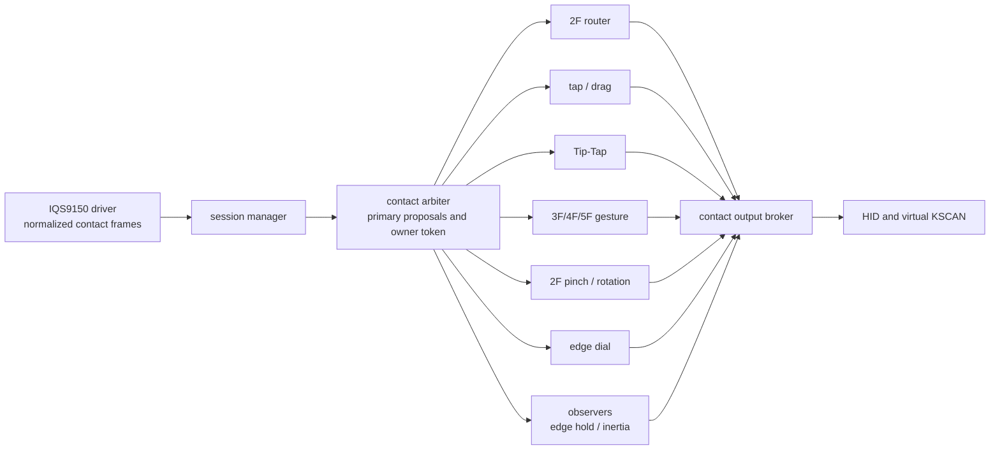

# Travelers Pad handoff / 引継ぎ書

Last updated: 2026-10-06

## External-module milestone / 外部module切り出し（最新）

Active branch: `refactor/external-trackpad-modules`, based on `main` `b0ad83d`.
Driver and ALL function implementation now live in independent local Git repositories
under `zmk-workspace/module/`, acquired by pinned west projects. Keyboard wiring,
feature node choices, virtual matrix, keymap, XIAO boot probe and regression assets
remain here. Shared DTS is supplied by the function module, not this repository.
See `docs/external-module-migration.md` for revisions, tests and limitations.

現在のbranchは`main`の`b0ad83d`から作成した`refactor/external-trackpad-modules`。
driverと全機能実装をworkspace/module配下の独立ローカルGit repoへ切り出し、westで固定取得する。
本repoには配線・機能nodeの選択・仮想matrix・keymap・XIAO診断・回帰資産を残す。
共通DTSは機能moduleが供給する。固定revision・検査・制約は上記文書参照。

User explicitly chose LOCAL ONLY. No GitHub repository creation or push is authorized.
Manifest file URLs point at the local source repositories; both repositories must be
preserved/copied for handoff until future publication is requested. `west update`
normally leaves them detached at the pinned revisions. Do not modify them without
first creating a branch. Workspace generated manifest was refreshed to the same pins.

ユーザーはローカルのみを明示選択。GitHub作成・pushは行わない。
file URLの取得元Git repoは将来の公開指示まで保持／別PCへコピーする必要がある。
west update後は固定revisionのdetached HEADになるため、変更前にbranchを作成する。
workspace生成manifestも同じrevisionへ更新済み。

Implementation/profile bytes and tuning are unchanged. Full DTS matches the baseline;
CONFIG changes only add module registration flags. Full-profile, driver-only and
pointer-profile builds and host inertia math pass, as do structural checks. Fresh
west clone was verified separately. UF2:
`C:\Users\takec\Downloads\travelers-pad-external-modules-20261006.uf2`.
Hardware approval pending; keep main unchanged until confirmation.

実装／共通profileのバイトと調整値は変更なし。生成DTSは旧版と一致し、CONFIG差分はmodule登録だけ。
全機能・driver単独・基本pointerのbuild、host慣性数学・構造検査は合格。別workspaceのwest取得も確認。
上記UF2の実機確認待ち。合格までこの切り出しはmainへ統合しない。
以下の内部module時代の記載は履歴で、この節を優先する。

## Reusable-module milestone / 再利用module整備（最新）

`main` includes the tuning milestone through `4303a03` and the hardware-approved
reusable-profile implementation `4988a42`. Driver/function Kconfig and source lists
are separated; `dts/travelers-pad/iqs9150-pointer.dtsi` supplies the board-independent
basic profile. The full XIAO shield imports it without changing tuned values or keys.
See `docs/reusable-modules.md`. This is still one Zephyr module/repository, not two
published repositories. Basic-profile KSCAN gestures/edge hold require further
integration and are not automatically imported. Different IC support is not claimed.

`main`へ`4303a03`までの調整と、実機合格済みの再利用profile実装`4988a42`を統合する。
driver/functionのKconfig・source listを分離し、
基本profileを共通DTSへ切り出した。完全XIAO shieldも同じ定義を取り込み、調整値・キーは維持。
詳細は上記文書。現時点では1つのZephyr module／repositoryであり、別repoの公開はまだしない。
基本profileはKSCANジェスチャー・edge holdを自動では導入しない。異なるICへの対応は未検証。
以下の旧branch・実機待ち記載は過去の履歴で、この節を優先する。

Build checks passed: full XIAO firmware, driver-only fixture, basic pointer fixture,
and both structural scripts. Full-profile UF2 for regression:
`C:\Users\takec\Downloads\travelers-pad-reusable-modules-20261006.uf2`.
User hardware approval received for pointer, taps, double-tap drag, two-finger
scroll/inertia, edges, Tip-Tap, multi-finger gestures and pinch. This checkpoint
is approved for main integration. No serial log was supplied for this confirmation.

完全XIAO firmware・driver単独・基本pointerのbuildと2種類の構造scriptは合格。
上記UF2でポインタ・タップ・ダブルタップドラッグ、2本指スクロール・慣性、
エッジ・Tip-Tap・多指ジェスチャー・ピンチの全項目についてユーザー実機合格を受領。
main統合可。この確認ではシリアルログの提出はなく、ユーザーの操作確認を根拠とする。

## Time-based inertia / 時間基準慣性（実機確認待ち）

Follow-up to `28da725`: hardware handoff jerk exposed double scaling. Inertia now
subscribes to private `iqs9150_wheel_observation`; the broker copies authorized
live wheel values before processors and never copies post-session output. No
parameters/decay changes. See `docs/inertia-canonical-wheel-test.md`; hardware
approval pending. Existing custom overlays require the private wheel input node.

`28da725`の切替段差ログから二重倍率を特定。慣性の観測を専用nodeへ分離し、brokerが
認可済みlive wheelのprocessor前の値を複製する。post-session出力は複製しない。
設定・減衰変更なし。上記検証文書参照。実機承認待ち。外部overlayは専用wheel入力nodeが必要。

Active branch: `feat/time-based-scroll-inertia`, baseline `d003657`.
Fixed-point speed estimation, fractional travel, half-life decay and stale-motion
rejection are implemented inside the inertia observer only. Initial settings:
half-life 250ms, smoothing 80ms, release timeout 120ms, stop speed 20 counts/s,
max duration 3000ms. Scaler 1/12, edge width 20 and transforms disabled are retained.
Legacy mode is available with half-life 0. See `docs/time-based-inertia-test.md`.
No merge to main until hardware approval.

現在は`d003657`を基準とする`feat/time-based-scroll-inertia`。慣性observer内だけで
固定小数点速度推定・移動端数保持・半減時間減衰・古い移動の棄却を実装。
初期値は半減250ms・平滑80ms・解放期限120ms・停止速度20count/s・上限3000ms。
倍率1/12・辺幅20・ピンチ回転無効を維持。半減時間0で従来方式へ戻る。
実機合格までmainへ統合しない。検証手順は上記文書。

## Tuning update / チューニング更新（2026-10-06）

Active branch: `feat/scroll-inertia-tuning`, based on `72e43c6`.
Independent disablement works, but pinch/rotation can cross-trigger; classification
design is deferred, not approved as final UX. Both are disabled in the tuning profile.
User-corrected values: edge width 20, wheel scaler 1/12, inertia delay/period 10ms,
decay 9/10, max delta 300; stop delta remains 2. Hardware check pending; see
`docs/scroll-inertia-tuning-test.md`. No algorithm or behavior-keymap changes.

現在は`72e43c6`を基準とした`feat/scroll-inertia-tuning`。
独立無効化は動くが、ピンチ／回転の交差発火が残るため識別設計は保留（最終UX合格ではない）。
調整profileでは両方無効。訂正された指定値は辺幅20、倍率1/12、慣性遅延・周期10ms、減衰9/10、
上限300。停止閾値2は維持。実機確認待ち。上記文書参照。アルゴリズム・Behavior割当は変更なし。

## Active adjustment / 現在の最終調整（2026-10-05）

Validated baseline checkpoint: `dfd0313` on `main` (no tracked changes at checkpoint).
Integrated edge-policy commit: `f848b42` on `main`. Edge dial checks the first contact frame
once per session; an interior start cannot acquire an edge later. Temporary contact
count changes preserve that decision, and reacquisition uses only the starting edge.
Edge widths and all other tuning remain unchanged. Hardware approval received;
see `docs/edge-start-only-test.md`. Active branch: `feat/transform-independent-toggle`.
Add `pinch-disabled` and `rotation-disabled` to the transform node independently.
The router reads the same settings through `transform-device` (configuration-only
dependency), including node status and feature CONFIG. Three USB-logging test UF2s
cover pinch only, rotation only and both disabled; hardware approval is pending.

実機確認済みの基準を`main`の`dfd0313`で保存（保存時点の追跡済み差分なし）。
辺取得の実装`f848b42`は実機承認されmainへ統合済み。辺取得資格をsession最初の接触frameで一度だけ
判定し、内側開始からの途中取得を禁止する。指本数の一時変化でも判断を保持し、再取得は
最初の辺に限定する。辺幅など他の設定は変更していない。検証手順は
`docs/edge-start-only-test.md`。現在は`feat/transform-independent-toggle`で
`pinch-disabled`／`rotation-disabled`による独立無効化を実装。
routerは`transform-device`で同じ設定・ノード状態・CONFIGを参照し、runtimeで競合recognizerを
呼び出す依存は追加しない。ピンチのみ・回転のみ・両方無効の3種類のUSBログ付きUF2で実機確認待ち。

Integration target: `main`
Development branch for this milestone: `feat/pinch-rotate`
Integrated commit: `c76e3e02cad944fb9025cf36930c4d2cc7852f5f` (main merge of feat/pinch-rotate)
Independent architecture review: **conditionally approved; continue hardening** /
独立architecture review: **条件付き承認・hardening継続**

## 1. Current objective / 現在の目的

This repository provides a ZMK firmware configuration and an IQS9150EV02
trackpad implementation for a Seeed XIAO nRF52840. The present milestone was
to finish the contact-session arbiter migration: every user-visible trackpad
action must be derived from a normalized contact session and authorized by one
deterministic owner path. The milestone is functionally complete and hardware
validated. The active follow-up adds host-visible pinch and rotation output;
its implementation and USB-logging UF2 build are complete, with hardware
verification pending.

本リポジトリは Seeed XIAO nRF52840 向けZMK firmware設定と、IQS9150EV02
trackpad実装を提供する。現在の節目は接触session arbiter移行の完了であった。すべての
ユーザー向けtrackpad操作は正規化済み接触sessionから導出され、決定的な単一所有者経路で
認可される。機能面でこの節目は完了し、実機検証済みである。現在のfollow-upはホストへ出力する
ピンチ・回転であり、実装とUSB logging UF2 buildが完了し、実機確認待ちである。

## 2. Hardware contract / ハードウェア接続

The established XIAO-to-IQS9150 assignment is:

| XIAO pin / XIAOピン | IQS9150 signal / IQS9150信号 |
|---|---|
| `3V3` | VDD |
| `GND` | GND |
| `xiao_11 / D10 / P1.15` | I2C SDA |
| `xiao_10 / D9 / P1.14` | I2C SCL |
| `xiao_9 / D8 / P1.13` | RDY (active-low) |
| `P1.12` | Unused; do **not** connect to EV02 MCLR / 未使用。EV02のMCLRへ接続しない |

Do not use the XIAO `5V` pin for the trackpad. The sensor has been detected at
I2C address `0x56`, product number `0x076a`.

XIAOの`5V`ピンはtrackpadに使用しない。P1.12はEV02 GUI設定を保持するためMCLRへ接続しない。
sensorはI2C address `0x56`、製品番号 `0x076a` として検出済みである。

## 3. Implemented behavior / 実装済み機能

| Area / 領域 | Current behavior / 現在の動作 |
|---|---|
| IQS9150 driver | EV02 image initialization, ATI, RDY-driven I2C transactions, up to five independent coordinates, normalized contact reporting |
| Startup robustness | Product-number retry for transient `0xeeee`; bounded automatic recovery for an ATI error caused by an early touch |
| 1F pointer | Relative pointer with discontinuity filtering |
| 2F scroll | Axis lock and wheel conversion; direction/scale supplied by the keyboard-side input processor chain |
| Tap and drag | 1F left, 2F right, 3F middle click; same-count double-tap then hold/move drag; release without meaningful move remains a double-click |
| Tip-Tap | Anchored two-finger left/right virtual-key action, repeatable while the anchor remains down |
| 3/4F gestures | Directional swipes mapped in the keymap |
| 5F gesture | Independent-coordinate Grasp/Release recognition, keymap action currently configurable |
| Pinch/rotation | Dedicated primary owner; incremental pinch-in/out and counter-clockwise/clockwise KSCAN actions; default bindings are Ctrl+-/Ctrl+= and F15/F16; hardware verification pending |
| Edge dial | Per-edge enablement, linear edge trace and local-circle continuation, virtual KSCAN actions |
| Edge hold continuation | Drag or axis-locked 2F scroll can continue at the forward edge; either scroll finger may trigger continuation |
| Inertia | Post-session 2F scroll inertia, token-associated with the committed scroll owner |
| Grid adapter | Optional 3x3 grid / edge-cell adapter exists but is disabled by default |

## 4. Architecture / アーキテクチャ



- `iqs9150_session` is the only raw normalized-contact subscriber.
  `iqs9150_session` は正規化済み生contactの唯一の購読者である。
- Six primary recognizers submit proposals for each frame: router, tap/drag,
  Tip-Tap, multi-finger gesture, edge dial, and transform gesture. The arbiter
  resolves one owner
  independently of callback registration order.
  primary recognizerはrouter、tap/drag、Tip-Tap、多指gesture、edge dial、
  transform gestureの6つである。
  arbiterはcallback登録順に依存せず、唯一のownerを決定する。
- The router forwards only after all primary proposals have been resolved.
  `edge_hold_continue` and `scroll_inertia` are observers, never primary owners.
  routerは全primary proposalの裁定後にのみframeをforwardする。edge holdとinertiaは
  observerであり、primary ownerにはならない。
- `contact_output_broker` is the only route for primary/observer REL, button,
  and virtual-KSCAN output. It validates the owner token, atomically consumes a
  terminal tap/double-click grant, and records held buttons for safe release.
  `contact_output_broker` はprimary/observerのREL、button、virtual-KSCAN出力の唯一の
 経路である。owner token検査、一回限りterminal tap/double-click grantの原子的消費、
  押下buttonの安全なreleaseを担当する。

Full details and tuneable properties are in
[`docs/architecture-and-tuning.md`](docs/architecture-and-tuning.md).
詳細と調整可能propertyは同文書を参照する。

## 5. Important decisions / 重要な判断

1. **Keep driver and function policy separated.** The driver only initializes,
   decodes, and normalizes sensor data. Gesture, click, scrolling, and key
   policy belong to function modules and keyboard configuration.
   **driverと機能policyを分離する。** driverは初期化・復号・正規化のみを担い、gesture、
   click、scroll、key policyはfunction moduleとkeyboard設定が担う。
2. **One repository-level function collection, not many external repositories.**
   Modules are currently kept under `src/function/iqs9150/`; optional features
   are enabled/disabled from the overlay/keymap. Avoid prematurely splitting
   the user-facing function set into many repositories.
   **機能群は一か所に集約する。** 現在は `src/function/iqs9150/` に置き、任意機能は
   overlay/keymapで有効・無効化する。早い段階で多数の外部repositoryへ分割しない。
3. **2F scroll remains an input-processor path.** Direction inversion and scale
   are keyboard-side settings, so UX tuning need not modify the driver.
   **2本指scrollはinput-processor経路を維持する。** 反転・倍率はkeyboard側設定であり、
   UX調整にdriver変更を不要とする。
4. **Edge dial remains a virtual-KSCAN/behavior path.** It intentionally does
   not share the 2F input-processor model; its bindings are ordinary keymap
   behaviors.
   **edge dialはvirtual-KSCAN/behavior経路を維持する。** 2F input-processorとは意図的に
   別であり、割当は通常のkeymap behaviorである。
5. **A double-tap does not press a drag button immediately.** On the second
   contact, release produces the second click; meaningful movement while held
   begins drag. This avoids the former immediate-double-click/drag conflict.
   **double-tapで即座にdrag buttonを押さない。** 2回目接触後、離せば2回目click、
   押したまま有意な移動があればdrag開始とする。
6. **Five fingers are Grasp/Release, not directional swipe.** 3F/4F retain
   directional swipes; 5F requires independent coordinates and is recognized
   as radial grasp/release.
   **5本指は方向swipeではなくGrasp/Releaseである。** 3本・4本指は方向swipeを維持し、
   5本指は独立座標から放射状に判定する。

## 6. Repository and commit guidance / repositoryとcommit方針

The arbiter completion, documentation, standalone west manifest, startup-ATI
recovery, and this handoff are the intended integration payload for `main`.
Before continuing work on another PC, check that `main` contains this payload
and that the worktree is clean.

arbiter完成、文書、単独west manifest、起動時ATI復旧、および本引継ぎ書が`main`へ統合する
対象である。別PCで作業を続ける前に、`main`にこのpayloadが存在しworktreeがcleanであることを
確認する。

Do not stage these user-owned review artifacts unless explicitly requested:

- `review-worktree-status.txt`
- `travelers-pad-review.bundle`

次のユーザー所有review artifactは、明示指示がない限りstageしないこと。

The intended newly added test documents include:

- `docs/arbiter-*-test.md`
- `docs/startup-ati-recovery-test.md`

## 7. Test status / テスト状況

### Passed / 合格

- Full hardware integration of pointer, 2F scroll, tap/drag, Tip-Tap, 3F/4F
  swipes, 5F Grasp/Release, edge dial, edge hold, and inertia.
- Tip-Tap left/right: arbiter owner grant and tap/drag suppression confirmed in
  serial logs; no terminal-action denial or unexpected click.
- Arbiter structural regression check:
  `./scripts/verify-contact-arbiter-architecture.sh` passes.
- Clean ZMK build for `seeeduino_xiao_ble` + `iqs9150_xiao` + USB logging
  passes.
- `nix develop --command just init config/zmk-config-travelers_pad` passes;
  `config/west.yml` now declares ZMK v0.3 and `zmk-input-matrix`.
- Startup with transient initial product read (`0xeeee`) reaches `Event Mode
  active`; pointer operation was confirmed on hardware after the reset-byte
  correction.

### Important log interpretation / 重要なログの読み方

- `qspi_nor: JEDEC id [85 60 15] expect [c8 40 15]` is a known XIAO external
  flash configuration warning and is unrelated to IQS9150 behavior.
- One early `product ... 0xeeee` followed by a successful product read is
  normal during sensor power-up; the driver retries asynchronously.
- Successful IQS9150 startup ends with
  `STEP1B complete: Event Mode active; touch the pad to produce reports`.

## 8. Startup ATI recovery / 起動時ATI自動復旧

Touching during the first ATI can produce `Info Flags=0x0118`
(`TP_REATI_OCCURRED | TP_ATI_ERROR`). The initial implementation treated this
as permanent ERROR. The current driver retries a bounded recovery:

1. emit a reset contact frame;
2. write the little-endian System Control software-reset value `0x0002`;
3. observe/acknowledge Show Reset;
4. reapply the EV02 image and ATI;
5. enter Event Mode.

最初のATI中の接触は `Info Flags=0x0118` を出し得る。以前は恒久ERRORとしていたが、
現行driverは接触reset frame、little-endianのsoftware reset `0x0002`、
Show Reset acknowledge、EV02 imageとATIの再実行、Event Mode到達を上限付きで行う。

The first recovery attempt used `0x0200` by mistake and stalled waiting for
Show Reset. This was fixed to `0x0002`, then built successfully. The normal
post-fix hardware startup and pointer were confirmed. If this robustness path
must be explicitly retested, follow
[`docs/startup-ati-recovery-test.md`](docs/startup-ati-recovery-test.md).

最初の復旧試行では誤って `0x0200` を送信しShow Reset待機で停止した。`0x0002`へ修正し、
ビルド成功済みである。修正後の通常起動とポインタは実機確認済みである。自動復旧経路を明示的に
再試験する場合は同テスト文書に従うこと。

## 9. Build and UF2 procedure / ビルドとUF2手順

Run from the ZMK workspace root (`~/zmk-workspace`):

```sh
nix develop --command just init config/zmk-config-travelers_pad

nix develop --command west build -p auto -s zmk/app \
  -d config/zmk-config-travelers_pad/build/iqs9150_xiao \
  -b seeeduino_xiao_ble -S zmk-usb-logging -- \
  -DSHIELD=iqs9150_xiao \
  -DZMK_CONFIG="$PWD/config/zmk-config-travelers_pad/config" \
  "-DZMK_EXTRA_MODULES=$PWD/config/zmk-config-travelers_pad;$PWD/module/zmk-input-matrix"
```

The semicolon in `ZMK_EXTRA_MODULES` is required; quote it so the shell does
not treat it as a command separator.

`ZMK_EXTRA_MODULES` の区切りはsemicolonであり、shellのcommand区切りにされないよう引用符で
囲む必要がある。

The generated UF2 is:

```text
config/zmk-config-travelers_pad/build/iqs9150_xiao/zephyr/zmk.uf2
```

Unless the user explicitly changes the policy, copy release/test UF2 files to
Windows Downloads (`/mnt/c/Users/takec/Downloads/`). Do not flash hardware from
the agent without explicit instruction.

明示的な方針変更がない限り、release/test UF2はWindows Downloads
（`/mnt/c/Users/takec/Downloads/`）へコピーする。明示指示なしにagentから実機へ書込みしない。

## 10. Remaining work / 未解決事項・次に行う作業

The next milestone is **arbiter safety hardening**. Preserve `06e334f` as the
development base; do not revert the accepted normal-path architecture.

次のmilestoneは **arbiter safety hardening** である。通常系として承認された`06e334f`を
開発baseとして維持し、以前の並列所有権構成へ戻さない。

| Order / 順序 | Priority / 優先度 | Task / タスク | Completion / 完了度 | Required verification / 必須検証 |
|---:|---|---|---:|---|
| 1 | P0 | Add a global lifecycle epoch and `arbiter_cancel_all()` that invalidate the current token, terminal grant, post-session lease, auxiliary lease, and observer/work generations even when no session is active / session外resetでも全token・lease・work世代を失効するglobal epochと`cancel_all` | Hardware smoke passed (user-reported) / 実機smoke確認済み（ユーザー報告） | Preserve the serial capture with the reset timing when repeating this test |
| 2 | P0 | Synchronize arbiter state or serialize every state mutation/output request in one execution context / arbiter stateをlock保護するか単一実行contextへ直列化 | Partial: state transitions, direct HID, and frame-bound routed-pointer authorization-to-enqueue are atomic; arbitrary virtual-KSCAN callbacks remain / 部分実装: state遷移、直接HID、frame-bound routed pointerの認可〜enqueueは原子的。任意virtual-KSCAN callbackが残る | Hardware-test reset and 1F→2F hand-off with queued routed frames; then isolate KSCAN callback dispatch |
| 3 | P0 | Give tap/drag, edge hold, and inertia work items captured generations; stop reinitializing work after asynchronous cancel / 各delayable workへ取得時generationを持たせ、非同期cancel後にworkを再初期化しない | Implementation complete: generations are invalidated and input-side cancellation synchronously quiesces old handlers before state replacement / 実装完了: 世代を失効し、入力側cancelは旧handler停止を待ってからstateを置換 | Cancel exactly at tap timer boundary; old work executing after a new session starts |
| 4 | P0 | Add an explicit session/generation-bound auxiliary lease for edge hold / edge holdへsession・generation付きauxiliary leaseを追加 | Hardware smoke passed (user-reported) / 実機smoke確認済み（ユーザー報告） | Preserve drag and scroll continuation serial captures when repeating this test |
| 5 | P0 | Make the broker own pending button-up and retry state, including terminal click press/release / brokerがterminal clickを含むpending button-upとretryを所有 | Implementation complete; fault injection pending / 実装完了・fault injection未確認 | Inject press success plus release enqueue failure; retry without duplicate release or stuck button |
| 6 | P1 | Correct Kconfig, init-priority, Devicetree phandle, and KSCAN dependencies; build a feature enable/disable matrix / feature単位の依存関係整理とbuild matrix | Complete — Kconfig dependency gates, structural check, and seven diagnostic overlays; full and all seven profiles produce UF2 / Kconfig依存gate・構造check・7診断overlay、full・全7 profileでUF2生成合格 | Run the matrix when changing a module dependency or diagnostic profile |
| 7 | P1 | Extract pinch/rotation geometry into a `TRANSFORM_GESTURE` primary owner and emit incremental four-direction KSCAN actions / pinch・rotationを専用primary ownerへ分離し、継続可能な4方向KSCAN actionを出力 | Implementation and USB-logging UF2 build complete; hardware verification pending / 実装・USB logging UF2 build合格、実機確認待ち | Verify pinch-in/out, both rotation directions, repeated steps, scroll priority, and no terminal 2F tap in one hardware run |
| 8 | P1 | Route the optional grid adapter through the output broker before enabling it / 任意grid adapterを有効化前にbroker経由へ移行 | Implemented on sibling branch `feat/arbiter-safety-hardening` at `5737d75`; intentionally excluded from this pinch/rotation branch / sibling branchで実装済み、このbranchからは意図的に除外 | Grid-only build and KSCAN token/cancel regression |
| 9 | P2 | Decide whether to migrate recognizers from reconstructed input events to one immutable complete `ContactFrame` transaction / immutable完全`ContactFrame`への移行判断・実装 | 0% | Frame completeness, sequence, and no mixed-generation contacts under stress |
| 10 | Monitor | Investigate the rare post-idle pointer freeze without adding power responsibility to the arbiter / 長時間idle後freezeの監視・診断 | Monitoring / 監視中 | Record last raw receive time, resolved/forward sequence, in-flight count, ack mask, enqueue failures, USB/battery state, and RESET/reconnect recovery |
| 11 | Later / 後続 | UX tuning such as pointer/scroll acceleration; retain keyboard-side 2F input processors / pointer・scroll加速等のUX調整 | Deferred / 保留 | Full integration test after each tuning change |

Complete items 1 and 2 as one foundation change before extending leases or
workers, because lifecycle invalidation is only reliable when state access is
synchronized. Implement items 3--5 in separate hardware-verifiable branches,
then perform item 6 as the release gate. Geometry and optional features follow
the safety milestone.

lifecycle失効はstate accessの同期なしには保証できないため、1と2を基盤変更として先に行う。
3〜5は実機確認可能な単位でbranchを分け、6のbuild matrixをrelease gateとする。geometryと
任意機能は安全性milestone完了後に進める。

## 11. Architecture migration score / アーキテクチャ移行度

2026-09-28 local audit: full USB-logging firmware builds successfully. The
first feature-matrix build exposed a missed transform composite phandle in all
seven diagnostic overlays; these now redirect the disabled transform child to
mock KSCAN. The dependency check now covers this regression. The full input
integration procedure now includes transform and distinguishes terminal tap
grants from drag owner tokens. Pinch/rotation hardware acceptance remains pending.

2026-09-28のこのPCでの点検: full USB logging buildは成功。診断matrixで7 overlayすべての
transform composite phandle差し替え漏れを検出し、無効transform childをmockへ変更した。
依存検査へ回帰防止を追加。全入力試験へtransformを追加し、終了tap grantとdrag tokenの違いを
修正した。pinch/rotation実機受入は未完了である。

For another IC, start with [docs/two-finger-interaction-flow.md](docs/two-finger-interaction-flow.md).
別ICへの移植は同文書から開始する。immutable完全frameは現行APIではなく未達設計である。

After the local overlay fix, all seven feature-matrix profiles passed clean builds
on this PC. Full USB-logging UF2 is saved as
`C:\Users\takec\Downloads\travelers-pad-transform-review.uf2`.
SHA-256: `0a7e5073c63218bf40ea3f41d5e1b5bbf28cd7f2b56003bf23e63efb003132ca`.
Build logs: `/tmp/travelers-pad-transform-build.log` and
`/tmp/travelers-pad-feature-matrix.log` (local temporary evidence, not versioned).
修正後、7 profileすべてこのPCでクリーンビルド合格。full USB logging UF2は上記Windows
Downloadsへ保存済み。まずtransformの8操作を実機確認し、続いてtap-drag・Tip-Tap・observerを
統合回帰確認する。ユーザー所有review artifact 2件はcommit対象から除外する。

### Production wiring acceptance / 本番機配線の受入（2026-10-04）

SDA/SCL/RDY now use P1.15/P1.14/P1.13 respectively (xiao_11/xiao_10/xiao_9).
The USB-logging firmware passed a pristine build, and generated DTS confirms
both I2C pinctrl states and the active-low RDY mapping. The user flashed the
production unit and confirmed operation. This accepts the wiring change;
dedicated pinch/rotation and failure-injection acceptance remain pending.

SDA/SCL/RDYをP1.15/P1.14/P1.13（xiao_11/xiao_10/xiao_9）へ変更した。
USB logging firmwareのクリーンビルドと生成DTSの確認に合格し、ユーザーが本番機へ
書き込んで動作確認した。配線変更は受入済み。pinch/rotation個別試験と異常系試験は未完了。

UF2: `C:\Users\takec\Downloads\travelers-pad-pin-remap-20261004.uf2`
SHA-256: `9c5fbfe88a1ad93d632abd7d06de73a791ce46eb53638136fa4efce0664eb746`.

### Next work / 次の作業

| Priority / 優先度 | Remaining task / 残タスク | Acceptance / 完了条件 |
|---|---|---|
| P0 | RDY logical-level checks / RDY論理極性確認 | `GPIO_ACTIVE_LOW` makes physical low logical 1; audit startup/recovery checks currently comparing against 0, then test cold boot, RESET, early touch and reconnect / 起動・復旧の0比較を点検し、起動・RESET・早期接触・再接続を確認 |
| P0 | Atomic virtual-KSCAN authorization and dispatch / KSCAN認可〜出力の競合対策 | No old action after cancel/reset between authorization and callback / 認可とcallbackの間にcancel/resetしても旧操作が出ない |
| P0 | Button release failure recovery / button-up失敗時復旧 | Fault-inject a failed release enqueue; verify retry even without later input and no stuck button / release enqueue失敗を注入し、その後入力なしでも復旧し押下が残らない |
| P1 | Pinch/rotation hardware acceptance / ピンチ・回転の実機受入 | Both directions, repeated actions and transitions; no scroll/right-click leakage / 両方向・反復・操作切替でscroll/右clickが混入しない |
| P1 | Delayed-work boundary regression / 遅延work境界の回帰 | Cancel at timer boundaries; old tap/inertia/edge-hold work cannot affect a new session / timer境界cancelで旧workが新sessionへ影響しない |
| P1 | Optional grid broker integration / 任意gridのbroker統合 | Review sibling-branch change before enabling; build and cancel tests / 別branchの変更を確認し、有効化前にbuild・cancel試験 |
| P2 | Immutable complete ContactFrame decision / 不変完全frameへの移行判断 | Document contract and test completeness, sequence and contact identity / 契約と完全性・連番・指IDを検証 |
| P2 | Documentation consistency / 文書整合 | Distinguish seven-contact implementation from five-finger hardware coverage / 最大7点の実装と5本指の検証範囲を区別 |
| Monitor / 監視 | Post-idle freeze / idle後freeze | Capture diagnostics if it recurs / 再発時に診断ログ取得 |
| Later / 後続 | Acceleration, UI snapshots, strength/area diagnostics / 加速・可視化・接触強度/面積診断 | Separate milestones after safety and transform acceptance / 安全性・transform受入後に別段階で実施 |

Normal user-visible paths: **100%**.
Overall migration including cancel, concurrency, output-failure safety, and
feature isolation: **70%**.

通常のユーザー操作経路: **100%**。
cancel、並行性、出力失敗時安全性、feature独立性を含む全体移行度: **70%**。

| Area / 領域状態 | Completion / 完了度 |
|---|---:|
| driver → normalized contact frames / 正規化接触frame | 100% |
| session boundary and frame numbering / session境界・frame連番 | 85% |
| six primary recognizer proposals / 6 primary recognizerのproposal | 100% |
| priority arbiter decision / 優先順位付きarbiter決定 | 100% |
| primary output token gate / primary出力のtoken gate | 85% |
| single ownership path / 単一の所有権経路 | 80% |
| edge hold and inertia arbiter integration / edge hold・inertiaのarbiter統合 | 80% |
| output failure recovery / 出力失敗時復旧 | 35% |
| feature-level disable independence / feature単位の無効化独立性 | 75% |
| immutable complete ContactFrame / immutable完全ContactFrame | 0% |
| documentation and regression coverage / 文書と回帰試験の整備 | 70% |

The independent review conditionally approves `06e334f` as the continuing
development base. It does **not** approve a final release or a 100% migration
claim until items 1--6 and their failure-path tests pass.

独立reviewは`06e334f`を継続開発baseとして条件付き承認した。上記1〜6と異常系testが
完了するまでは、最終releaseおよび移行100%とは判定しない。
# Latest checkpoint / 最新チェックポイント（2026-10-06）

User-completed manual tuning is retained: smooth scrolling enabled, wheel scaler
1/4, edge behavior velocity 1200. Pinch is enabled; rotation remains disabled.
Time-based inertia and canonical pre-processor wheel observation are integrated.
Pinch-only final UF2 was built; its latest hardware result has not been separately
reported. Preserve the user-edited keymap (including Tip-Tap and transform keys).
Next milestone: reusable, board-independent driver/function integration profiles.

ユーザーの手動調整を維持：高解像度スクロール有効、ホイール倍率1/4、辺Behavior速度1200。
ピンチ有効・回転無効。時間基準慣性とprocessor前の専用wheel観測を統合する。
ピンチのみ有効な最終UF2はbuild済みだが、その実機結果は別途未報告。
Tip-Tap・transformなどユーザー編集のキーマップを保持する。
次の段階は基板非依存のドライバー／機能取り込みprofile整備。
以下の古いブランチ・設定記載は履歴であり、この節を優先する。
