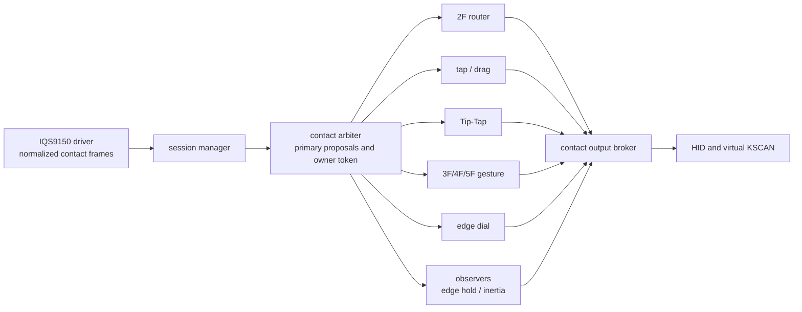

# Travelers Pad handoff / 引継ぎ書

Last updated: 2026-09-14
Integration target: `main`
Development branch for this milestone: `feat/arbiter-lifecycle-leases`
Integrated commit: `06e334f0626d250a3a8b8bc0f16ba6a35cf72c93`
Independent architecture review: **conditionally approved; continue hardening** /
独立architecture review: **条件付き承認・hardening継続**

## 1. Current objective / 現在の目的

This repository provides a ZMK firmware configuration and an IQS9150EV02
trackpad implementation for a Seeed XIAO nRF52840. The present milestone was
to finish the contact-session arbiter migration: every user-visible trackpad
action must be derived from a normalized contact session and authorized by one
deterministic owner path. The milestone is functionally complete and hardware
validated.

本リポジトリは Seeed XIAO nRF52840 向けZMK firmware設定と、IQS9150EV02
trackpad実装を提供する。現在の節目は接触session arbiter移行の完了であった。すべての
ユーザー向けtrackpad操作は正規化済み接触sessionから導出され、決定的な単一所有者経路で
認可される。機能面でこの節目は完了し、実機検証済みである。

## 2. Hardware contract / ハードウェア接続

The established XIAO-to-IQS9150 assignment is:

| XIAO pin / XIAOピン | IQS9150 signal / IQS9150信号 |
|---|---|
| `3V3` | VDD |
| `GND` | GND |
| `P1.14` | I2C SDA |
| `P1.13` | I2C SCL |
| `P1.15` | RDY (active-low) |
| `P1.12` | Unused; do **not** connect to EV02 MCLR / 未使用。EV02のMCLRへ接続しない |

Do not use the XIAO `5V` pin for the trackpad. The sensor has been detected at
I2C address `0x56`, product number `0x076a`.

XIAOの`5V`ピンはtrackpadに使用しない。P1.12はEV02 GUI設定を保持するためMCLRへ接続しない。
sensorはI2C address `0x56`、製品番号 `0x076a` として検出済みである。

## 3. Implemented behavior / 実装済み機能

| Area / 領域 | Current behavior / 現在の動作 |
|---|---|
| IQS9150 driver | EV02 image initialization, ATI, RDY-driven I2C transactions, up to five independent coordinates, normalized contact reporting |
| Startup robustness | Product-number retry for transient `0xeeee`; bounded automatic recovery for an ATI error caused by an early touch |
| 1F pointer | Relative pointer with discontinuity filtering |
| 2F scroll | Axis lock and wheel conversion; direction/scale supplied by the keyboard-side input processor chain |
| Tap and drag | 1F left, 2F right, 3F middle click; same-count double-tap then hold/move drag; release without meaningful move remains a double-click |
| Tip-Tap | Anchored two-finger left/right virtual-key action, repeatable while the anchor remains down |
| 3/4F gestures | Directional swipes mapped in the keymap |
| 5F gesture | Independent-coordinate Grasp/Release recognition, keymap action currently configurable |
| Edge dial | Per-edge enablement, linear edge trace and local-circle continuation, virtual KSCAN actions |
| Edge hold continuation | Drag or axis-locked 2F scroll can continue at the forward edge; either scroll finger may trigger continuation |
| Inertia | Post-session 2F scroll inertia, token-associated with the committed scroll owner |
| Grid adapter | Optional 3x3 grid / edge-cell adapter exists but is disabled by default |

## 4. Architecture / アーキテクチャ



- `iqs9150_session` is the only raw normalized-contact subscriber.
  `iqs9150_session` は正規化済み生contactの唯一の購読者である。
- Five primary recognizers submit proposals for each frame: router, tap/drag,
  Tip-Tap, multi-finger gesture, and edge dial. The arbiter resolves one owner
  independently of callback registration order.
  primary recognizerはrouter、tap/drag、Tip-Tap、多指gesture、edge dialの5つである。
  arbiterはcallback登録順に依存せず、唯一のownerを決定する。
- The router forwards only after all primary proposals have been resolved.
  `edge_hold_continue` and `scroll_inertia` are observers, never primary owners.
  routerは全primary proposalの裁定後にのみframeをforwardする。edge holdとinertiaは
  observerであり、primary ownerにはならない。
- `contact_output_broker` is the only route for primary/observer REL, button,
  and virtual-KSCAN output. It validates the owner token, atomically consumes a
  terminal tap/double-click grant, and records held buttons for safe release.
  `contact_output_broker` はprimary/observerのREL、button、virtual-KSCAN出力の唯一の
 経路である。owner token検査、一回限りterminal tap/double-click grantの原子的消費、
  押下buttonの安全なreleaseを担当する。

Full details and tuneable properties are in
[`docs/architecture-and-tuning.md`](docs/architecture-and-tuning.md).
詳細と調整可能propertyは同文書を参照する。

## 5. Important decisions / 重要な判断

1. **Keep driver and function policy separated.** The driver only initializes,
   decodes, and normalizes sensor data. Gesture, click, scrolling, and key
   policy belong to function modules and keyboard configuration.
   **driverと機能policyを分離する。** driverは初期化・復号・正規化のみを担い、gesture、
   click、scroll、key policyはfunction moduleとkeyboard設定が担う。
2. **One repository-level function collection, not many external repositories.**
   Modules are currently kept under `src/function/iqs9150/`; optional features
   are enabled/disabled from the overlay/keymap. Avoid prematurely splitting
   the user-facing function set into many repositories.
   **機能群は一か所に集約する。** 現在は `src/function/iqs9150/` に置き、任意機能は
   overlay/keymapで有効・無効化する。早い段階で多数の外部repositoryへ分割しない。
3. **2F scroll remains an input-processor path.** Direction inversion and scale
   are keyboard-side settings, so UX tuning need not modify the driver.
   **2本指scrollはinput-processor経路を維持する。** 反転・倍率はkeyboard側設定であり、
   UX調整にdriver変更を不要とする。
4. **Edge dial remains a virtual-KSCAN/behavior path.** It intentionally does
   not share the 2F input-processor model; its bindings are ordinary keymap
   behaviors.
   **edge dialはvirtual-KSCAN/behavior経路を維持する。** 2F input-processorとは意図的に
   別であり、割当は通常のkeymap behaviorである。
5. **A double-tap does not press a drag button immediately.** On the second
   contact, release produces the second click; meaningful movement while held
   begins drag. This avoids the former immediate-double-click/drag conflict.
   **double-tapで即座にdrag buttonを押さない。** 2回目接触後、離せば2回目click、
   押したまま有意な移動があればdrag開始とする。
6. **Five fingers are Grasp/Release, not directional swipe.** 3F/4F retain
   directional swipes; 5F requires independent coordinates and is recognized
   as radial grasp/release.
   **5本指は方向swipeではなくGrasp/Releaseである。** 3本・4本指は方向swipeを維持し、
   5本指は独立座標から放射状に判定する。

## 6. Repository and commit guidance / repositoryとcommit方針

The arbiter completion, documentation, standalone west manifest, startup-ATI
recovery, and this handoff are the intended integration payload for `main`.
Before continuing work on another PC, check that `main` contains this payload
and that the worktree is clean.

arbiter完成、文書、単独west manifest、起動時ATI復旧、および本引継ぎ書が`main`へ統合する
対象である。別PCで作業を続ける前に、`main`にこのpayloadが存在しworktreeがcleanであることを
確認する。

Do not stage these user-owned review artifacts unless explicitly requested:

- `review-worktree-status.txt`
- `travelers-pad-review.bundle`

次のユーザー所有review artifactは、明示指示がない限りstageしないこと。

The intended newly added test documents include:

- `docs/arbiter-*-test.md`
- `docs/startup-ati-recovery-test.md`

## 7. Test status / テスト状況

### Passed / 合格

- Full hardware integration of pointer, 2F scroll, tap/drag, Tip-Tap, 3F/4F
  swipes, 5F Grasp/Release, edge dial, edge hold, and inertia.
- Tip-Tap left/right: arbiter owner grant and tap/drag suppression confirmed in
  serial logs; no terminal-action denial or unexpected click.
- Arbiter structural regression check:
  `./scripts/verify-contact-arbiter-architecture.sh` passes.
- Clean ZMK build for `seeeduino_xiao_ble` + `iqs9150_xiao` + USB logging
  passes.
- `nix develop --command just init config/zmk-config-travelers_pad` passes;
  `config/west.yml` now declares ZMK v0.3 and `zmk-input-matrix`.
- Startup with transient initial product read (`0xeeee`) reaches `Event Mode
  active`; pointer operation was confirmed on hardware after the reset-byte
  correction.

### Important log interpretation / 重要なログの読み方

- `qspi_nor: JEDEC id [85 60 15] expect [c8 40 15]` is a known XIAO external
  flash configuration warning and is unrelated to IQS9150 behavior.
- One early `product ... 0xeeee` followed by a successful product read is
  normal during sensor power-up; the driver retries asynchronously.
- Successful IQS9150 startup ends with
  `STEP1B complete: Event Mode active; touch the pad to produce reports`.

## 8. Startup ATI recovery / 起動時ATI自動復旧

Touching during the first ATI can produce `Info Flags=0x0118`
(`TP_REATI_OCCURRED | TP_ATI_ERROR`). The initial implementation treated this
as permanent ERROR. The current driver retries a bounded recovery:

1. emit a reset contact frame;
2. write the little-endian System Control software-reset value `0x0002`;
3. observe/acknowledge Show Reset;
4. reapply the EV02 image and ATI;
5. enter Event Mode.

最初のATI中の接触は `Info Flags=0x0118` を出し得る。以前は恒久ERRORとしていたが、
現行driverは接触reset frame、little-endianのsoftware reset `0x0002`、
Show Reset acknowledge、EV02 imageとATIの再実行、Event Mode到達を上限付きで行う。

The first recovery attempt used `0x0200` by mistake and stalled waiting for
Show Reset. This was fixed to `0x0002`, then built successfully. The normal
post-fix hardware startup and pointer were confirmed. If this robustness path
must be explicitly retested, follow
[`docs/startup-ati-recovery-test.md`](docs/startup-ati-recovery-test.md).

最初の復旧試行では誤って `0x0200` を送信しShow Reset待機で停止した。`0x0002`へ修正し、
ビルド成功済みである。修正後の通常起動とポインタは実機確認済みである。自動復旧経路を明示的に
再試験する場合は同テスト文書に従うこと。

## 9. Build and UF2 procedure / ビルドとUF2手順

Run from the ZMK workspace root (`~/zmk-workspace`):

```sh
nix develop --command just init config/zmk-config-travelers_pad

nix develop --command west build -p auto -s zmk/app \
  -d config/zmk-config-travelers_pad/build/iqs9150_xiao \
  -b seeeduino_xiao_ble -S zmk-usb-logging -- \
  -DSHIELD=iqs9150_xiao \
  -DZMK_CONFIG="$PWD/config/zmk-config-travelers_pad/config" \
  "-DZMK_EXTRA_MODULES=$PWD/config/zmk-config-travelers_pad;$PWD/module/zmk-input-matrix"
```

The semicolon in `ZMK_EXTRA_MODULES` is required; quote it so the shell does
not treat it as a command separator.

`ZMK_EXTRA_MODULES` の区切りはsemicolonであり、shellのcommand区切りにされないよう引用符で
囲む必要がある。

The generated UF2 is:

```text
config/zmk-config-travelers_pad/build/iqs9150_xiao/zephyr/zmk.uf2
```

Unless the user explicitly changes the policy, copy release/test UF2 files to
Windows Downloads (`/mnt/c/Users/takec/Downloads/`). Do not flash hardware from
the agent without explicit instruction.

明示的な方針変更がない限り、release/test UF2はWindows Downloads
（`/mnt/c/Users/takec/Downloads/`）へコピーする。明示指示なしにagentから実機へ書込みしない。

## 10. Remaining work / 未解決事項・次に行う作業

The next milestone is **arbiter safety hardening**. Preserve `06e334f` as the
development base; do not revert the accepted normal-path architecture.

次のmilestoneは **arbiter safety hardening** である。通常系として承認された`06e334f`を
開発baseとして維持し、以前の並列所有権構成へ戻さない。

| Order / 順序 | Priority / 優先度 | Task / タスク | Completion / 完了度 | Required verification / 必須検証 |
|---:|---|---|---:|---|
| 1 | P0 | Add a global lifecycle epoch and `arbiter_cancel_all()` that invalidate the current token, terminal grant, post-session lease, auxiliary lease, and observer/work generations even when no session is active / session外resetでも全token・lease・work世代を失効するglobal epochと`cancel_all` | Hardware smoke passed (user-reported) / 実機smoke確認済み（ユーザー報告） | Preserve the serial capture with the reset timing when repeating this test |
| 2 | P0 | Synchronize arbiter state or serialize every state mutation/output request in one execution context / arbiter stateをlock保護するか単一実行contextへ直列化 | Partial: state transitions, direct HID, and frame-bound routed-pointer authorization-to-enqueue are atomic; arbitrary virtual-KSCAN callbacks remain / 部分実装: state遷移、直接HID、frame-bound routed pointerの認可〜enqueueは原子的。任意virtual-KSCAN callbackが残る | Hardware-test reset and 1F→2F hand-off with queued routed frames; then isolate KSCAN callback dispatch |
| 3 | P0 | Give tap/drag, edge hold, and inertia work items captured generations; stop reinitializing work after asynchronous cancel / 各delayable workへ取得時generationを持たせ、非同期cancel後にworkを再初期化しない | Implementation complete: generations are invalidated and input-side cancellation synchronously quiesces old handlers before state replacement / 実装完了: 世代を失効し、入力側cancelは旧handler停止を待ってからstateを置換 | Cancel exactly at tap timer boundary; old work executing after a new session starts |
| 4 | P0 | Add an explicit session/generation-bound auxiliary lease for edge hold / edge holdへsession・generation付きauxiliary leaseを追加 | Hardware smoke passed (user-reported) / 実機smoke確認済み（ユーザー報告） | Preserve drag and scroll continuation serial captures when repeating this test |
| 5 | P0 | Make the broker own pending button-up and retry state, including terminal click press/release / brokerがterminal clickを含むpending button-upとretryを所有 | Implementation complete; fault injection pending / 実装完了・fault injection未確認 | Inject press success plus release enqueue failure; retry without duplicate release or stuck button |
| 6 | P1 | Correct Kconfig, init-priority, Devicetree phandle, and KSCAN dependencies; build a feature enable/disable matrix / feature単位の依存関係整理とbuild matrix | Complete — Kconfig dependency gates, structural check, and seven diagnostic overlays; full and all seven profiles produce UF2 / Kconfig依存gate・構造check・7診断overlay、full・全7 profileでUF2生成合格 | Run the matrix when changing a module dependency or diagnostic profile |
| 7 | P1 | Extract pinch/rotation geometry into a `TRANSFORM_GESTURE` primary owner with `PINCH`, `ROTATE`, and `PINCH_ROTATE` submodes / pinch・rotationを専用primary ownerへ分離 | Implementation complete; full UF2 built, hardware verification pending / 実装完了・full UF2 build合格、実機確認待ち | Once geometry commits, release must never fall back to a 2F tap; verify SCROLL priority evidence |
| 8 | P1 | Route the optional grid adapter through the output broker before enabling it / 任意grid adapterを有効化前にbroker経由へ移行 | 0% | Grid-only build and KSCAN token/cancel regression |
| 9 | P2 | Decide whether to migrate recognizers from reconstructed input events to one immutable complete `ContactFrame` transaction / immutable完全`ContactFrame`への移行判断・実装 | 0% | Frame completeness, sequence, and no mixed-generation contacts under stress |
| 10 | Monitor | Investigate the rare post-idle pointer freeze without adding power responsibility to the arbiter / 長時間idle後freezeの監視・診断 | Monitoring / 監視中 | Record last raw receive time, resolved/forward sequence, in-flight count, ack mask, enqueue failures, USB/battery state, and RESET/reconnect recovery |
| 11 | Later / 後続 | UX tuning such as pointer/scroll acceleration; retain keyboard-side 2F input processors / pointer・scroll加速等のUX調整 | Deferred / 保留 | Full integration test after each tuning change |

Complete items 1 and 2 as one foundation change before extending leases or
workers, because lifecycle invalidation is only reliable when state access is
synchronized. Implement items 3--5 in separate hardware-verifiable branches,
then perform item 6 as the release gate. Geometry and optional features follow
the safety milestone.

lifecycle失効はstate accessの同期なしには保証できないため、1と2を基盤変更として先に行う。
3〜5は実機確認可能な単位でbranchを分け、6のbuild matrixをrelease gateとする。geometryと
任意機能は安全性milestone完了後に進める。

## 11. Architecture migration score / アーキテクチャ移行度

Normal user-visible paths: **100%**.
Overall migration including cancel, concurrency, output-failure safety, and
feature isolation: **70%**.

通常のユーザー操作経路: **100%**。
cancel、並行性、出力失敗時安全性、feature独立性を含む全体移行度: **70%**。

| Area / 領域状態 | Completion / 完了度 |
|---|---:|
| driver → normalized contact frames / 正規化接触frame | 100% |
| session boundary and frame numbering / session境界・frame連番 | 85% |
| five primary recognizer proposals / 5 primary recognizerのproposal | 100% |
| priority arbiter decision / 優先順位付きarbiter決定 | 100% |
| primary output token gate / primary出力のtoken gate | 85% |
| single ownership path / 単一の所有権経路 | 80% |
| edge hold and inertia arbiter integration / edge hold・inertiaのarbiter統合 | 80% |
| output failure recovery / 出力失敗時復旧 | 35% |
| feature-level disable independence / feature単位の無効化独立性 | 75% |
| immutable complete ContactFrame / immutable完全ContactFrame | 0% |
| documentation and regression coverage / 文書と回帰試験の整備 | 70% |

The independent review conditionally approves `06e334f` as the continuing
development base. It does **not** approve a final release or a 100% migration
claim until items 1--6 and their failure-path tests pass.

独立reviewは`06e334f`を継続開発baseとして条件付き承認した。上記1〜6と異常系testが
完了するまでは、最終releaseおよび移行100%とは判定しない。
