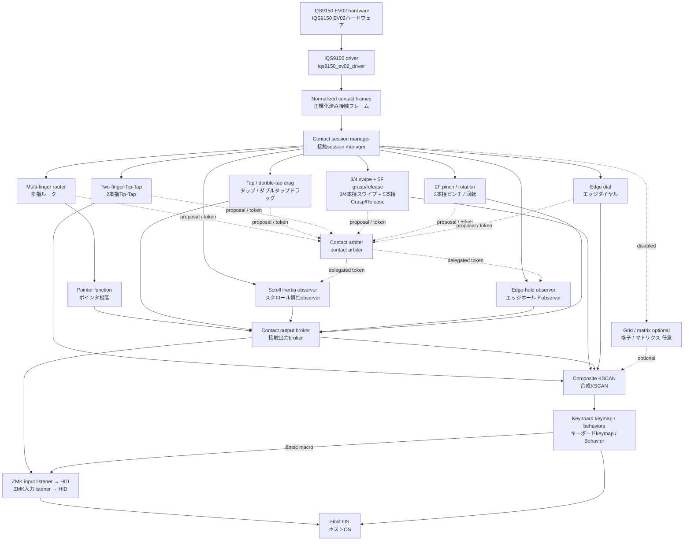

# Travelers Pad architecture and tuning / アーキテクチャと調整

This document describes the current IQS9150 implementation. It separates the
sensor driver, reusable function modules, and keyboard-specific ZMK settings.
It also marks functions that are present but disabled or not assigned.

この文書は現在のIQS9150実装を対象とします。センサードライバ、再利用可能な
機能モジュール、キーボード固有のZMK設定を分離して説明します。実装済みでも無効、
または未割当の機能は明記します。

## Dependency graph / 依存関係



`iqs9150_session` is the sole raw-frame subscriber and republishes normalized
frames to every function. Its contact arbiter is the single authority for
contact ownership: the six primary recognizers submit proposals, it waits for
their queued-frame acknowledgements, then emits one deterministic owner token.
The router receives a complete-frame callback only after that decision, so it
cannot forward a pointer or scroll contact frame while a later recognizer may
still claim the same raw frame. Primary first and continuation output is
capability-gated by that token. The contact output broker is the only
host-facing `REL_*`/mouse-button transport and primary virtual-KSCAN pulse
transport for pointer, tap/drag, edge-hold, inertia, edge dial, Tip-Tap,
multi-finger gesture, and transform paths. It checks the matching primary token, auxiliary
delegation, post-session lease, or a one-shot terminal action grant immediately
before emitting. A terminal grant is minted only from a fully resolved normal
release and is consumed exactly once for a tap or double-click.

There is no provisional-owner token or pass-through owner: until the six
primary proposals resolve, a frame has no owner. A consumer which needs the
new decision must use its resolved-frame callback.

`iqs9150_scroll_inertia` and `iqs9150_edge_hold_continue` do not join the
primary decision barrier. They receive the already-resolved immutable frame as
observers, but only after each observer has first consumed its own raw frame.
Thus enabling, disabling, or scheduling either observer cannot delay
pointer/scroll ownership selection, nor can an observer act on incomplete
per-contact data.

`iqs9150_scroll_inertia` and `iqs9150_edge_hold_continue` are passive
observers. They never make an ownership claim. Edge hold emits only while an
**ACTIVE** drag or scroll token delegates the required capability; a reserved
double-tap drag cannot move at an edge before button-down succeeds. Inertia
starts only after a normal physical scroll release obtains a revocable
post-session lease; new contact or cancellation revokes it. Terminal button
release is recorded diagnostically and remains fail-safe only for a button
actually pressed by the trackpad source. The broker's held-button ledger keys
that release by input device, ownership frame, recognizer, owner, and button,
so a stale trackpad path cannot release a matching button held elsewhere.

`iqs9150_session` は唯一の生frame購読者であり、正規化frameを全機能へ再配信します。
contact arbiterが接触所有権の唯一のauthorityである。6つのprimary recognizerがproposalを
提出し、queue経由の全frame確認後に、決定的なowner tokenを一つ発行する。routerはその決定後
だけcomplete-frame callbackを受け取るため、後から呼ばれるrecognizerが同じ生frameをclaim
できる間はポインタ／scroll接触frameをforwardしない。primaryの初回・継続出力は、このtokenの
capabilityでgateする。contact output brokerはpointer、tap/drag、edge-hold、inertia、edge dial、
Tip-Tap、多指gesture経路における唯一のホスト向け`REL_*`／マウスボタンtransportおよび
primary仮想KSCAN pulse transportであり、
出力直前に一致するprimary token、auxiliary委譲、post-session lease、または一回限りの
terminal-action grantを検査する。terminal grantは完全に裁定された通常releaseからだけ発行され、
tapまたはdouble-clickのために一度だけ消費される。

暫定owner tokenやpass-through ownerは存在しない。6 primary proposalの裁定が終わるまでは、
frameにownerは存在しない。新しい決定を必要とするconsumerは、裁定済みframe callbackを使う。

`iqs9150_scroll_inertia` と `iqs9150_edge_hold_continue` はprimary裁定barrierへ参加しない。
これらは各observer自身が生frameを消費した**後**に、裁定済みの不変frameをobserverとして受け取る。
従って、いずれかのobserverの有効・無効や実行順はpointer/scroll所有権の決定を遅らせず、observerが
未完成の接触別dataを使って動作することもない。

`iqs9150_scroll_inertia` と `iqs9150_edge_hold_continue` は受動observerであり、所有権を
claimしない。edge holdは **ACTIVE** なdragまたはscroll tokenから必要なcapabilityを委譲された
間だけ出力する。予約済みdouble-tap dragはbutton-down成功前に辺で移動できない。inertiaは通常の
scroll release後に取消可能なpost-session leaseを取得した場合だけ開始し、新規接触または
cancellationで失効する。terminal button releaseは診断用に記録し、trackpad source自身が実際に
押したbuttonだけを安全側でreleaseする。brokerのheld-button ledgerは入力device、所有権frame、
recognizer、owner、buttonでreleaseを照合するため、staleなtrackpad経路が別経路の同一buttonを
releaseできない。

## Internal layout / 内部配置

The repository is already arranged along the future repository boundary. This
is only an internal move: compatible strings, Kconfig symbols, Devicetree
properties, and keyboard settings are unchanged.

リポジトリは将来のリポジトリ境界に沿って既に配置しています。これは内部移動だけであり、
compatible文字列、Kconfigシンボル、Devicetreeプロパティ、キーボード設定は変わりません。

```text
src/
├── driver/iqs9150/                 # Future zmk-iqs9150-driver
│   ├── iqs9150_ev02_driver.c
│   └── iqs9150_ev02_init.h
├── function/iqs9150/               # Future zmk-iqs9150-functions
│   ├── core/                        # Router + pointer/2F scroll
│   ├── tap_drag/
│   ├── multifinger_gesture/
│   ├── edge_dial/
│   └── grid_adapter/                # Optional; disabled by default
└── platform/xiao/                   # XIAO-specific diagnostics
```

## Layer responsibilities / レイヤーごとの責務

| Layer / 層 | Component / 構成要素 | Responsibility / 責務 | Output / 出力 | Status / 状態 |
|---|---|---|---|---|
| Sensor driver / センサードライバ | `src/driver/iqs9150/iqs9150_ev02_driver.c` | I2C, EV02 initialization, ATI, product/status validation, contact decoding, up to five contact coordinates / I2C、EV02初期化、ATI、製品・状態検証、接触復号、最大5点座標 | Normalized absolute contact frames / 正規化済み絶対座標フレーム | Enabled / 有効 |
| Contact session / 接触session | `iqs9150_session`, `contact_arbiter`, `contact_output_broker` | Session ID, normal-end/cancel boundary, proposal collection, deterministic resolver, token authority, and token-checked host output transport / session ID、通常終了・cancel境界、proposal収集、決定的resolver、token authority、token検査済みホスト出力transport | Republished contact frames; owner token; brokered `REL_*`/button output / 再配信接触frame、owner token、broker経由の`REL_*`／button出力 | Enabled; output broker covers pointer/tap-drag/edge-hold/inertia / 有効・brokerはpointer/tap-drag/edge-hold/inertiaを担当 |
| Arbitration / 排他制御 | `iqs9150_multifinger_router` | Observes/proposes first, then forwards pointer or 2F scroll only from the arbiter complete-frame callback / まず観測・proposalを行い、arbiterのcomplete-frame callbackからのみポインタ／2本指scrollをforward | Routed contact frames / 振り分け済み接触フレーム | Arbiter-authoritative; callback-order independent / arbiterが正・callback順非依存 |
| Pointer / ポインタ | `iqs9150_pointer` | 1F relative pointer; 2F axis lock, discontinuity rejection, and wheel conversion / 1本指相対ポインタ、2本指軸ロック・不連続除外・ホイール変換 | `REL_X/Y`, `REL_WHEEL/HWHEEL` | Enabled / 有効 |
| Tap/drag / タップ・ドラッグ | `iqs9150_tap_drag` | 1/2/3F click; same-count double-tap + hold + move drag / 1/2/3本指クリック、同本数ダブルタップ+ホールド+移動ドラッグ | Mouse buttons and relative movement / マウスボタン・相対移動 | Token-gated / tokenでgate |
| Tip-Tap / Tip-Tap | `iqs9150_tip_tap` | Anchored 2F left/right virtual-key tap; repeats while the anchor stays down / anchorを維持した2本指左右の仮想キーtap、anchor維持中は繰返し可能 | Virtual KSCAN | Token-gated; one token per anchored interaction / tokenでgate・anchor操作ごとに一つ |
| Multi-finger gesture / 多指ジェスチャー | `iqs9150_multifinger_gesture_kscan` | 3/4F directional swipe; 5F independent-coordinate Grasp/Release / 3/4本指方向スワイプ、5本指独立座標Grasp/Release | Virtual KSCAN | Token-gated; one token per contact session / tokenでgate・接触sessionごとに一つ |
| Edge / エッジ | `iqs9150_edge_dial_kscan` | Claims a 1F contact started on an enabled edge; linear trace and local-circle continuation produce repeated virtual KSCAN steps / 有効辺から始まる1本指接触を取得し、直線・局所円継続を仮想KSCANステップ化 | Virtual KSCAN | Token-gated; one token per contact session / tokenでgate・接触sessionごとに一つ |
| Grid / 格子 | `iqs9150_grid_kscan`, `iqs9150_matrix_input`, `zmk-input-matrix` | 3×3 grid tap/flick and optional edge cells / 3×3格子タップ・フリックと任意エッジセル | Virtual KSCAN | Disabled / 無効 |
| ZMK integration / ZMK統合 | Composite KSCAN, keymap, `&kp`, `&mkp`, `&msc` | Maps virtual KSCAN positions to host functions / 仮想KSCAN位置をホスト機能へ割当 | HID reports / HIDレポート | Enabled where mapped / 割当箇所のみ有効 |

## Current keyboard assignment / 現在のキーボード割当

These are keyboard-level bindings in `config/iqs9150_xiao.keymap`; they can be
replaced without changing the sensor driver or function modules.

以下は `config/iqs9150_xiao.keymap` のキーボード側割当です。センサードライバや
機能モジュールを変更せず置換できます。

| Source / 入力 | Direction or action / 方向・操作 | Current binding / 現在の割当 |
|---|---|---|
| 3F swipe / 3本指スワイプ | Left / Right / 左・右 | Mouse Back `MB4` / Mouse Forward `MB5` |
| 3F swipe / 3本指スワイプ | Up / Down / 上・下 | Page Up / Page Down |
| 4F swipe / 4本指スワイプ | Left / Right / Up / Down | Win+Arrow / Win+矢印 |
| 5F geometry / 5本指ジオメトリ | Grasp / Release | Win+M / Win+Shift+M |
| Left edge / 左端 | Down / Up / 下・上 | Brightness down / up / 輝度下げ・上げ |
| Right edge / 右端 | Down / Up / 下・上 | Vertical scroll down / up / 縦スクロール下・上 |
| Top edge / 上端 | Right / Left / 右・左 | Volume up / down / 音量上げ・下げ |
| Bottom edge / 下端 | Right / Left / 右・左 | Horizontal scroll right / left / 横スクロール右・左 |

## Tuning ownership / 調整項目と所有層

Use the keyboard configuration first for user-preference changes. Use function
module properties for recognition thresholds or hardware geometry. Change the
sensor driver only for IQS9150 protocol, initialization, or contact-decoding
issues.

ユーザーの好みはまずキーボード設定で調整します。認識閾値やハードウェア形状は機能
モジュールのプロパティで調整します。IQS9150通信、初期化、接触復号の問題だけを
センサードライバで変更します。

| Function / 機能 | Settings / 設定 | Configure in / 設定場所 | Change scope / 影響範囲 |
|---|---|---|---|
| Host assignment / ホスト割当 | Gesture/edge bindings, `&kp`, `&mkp`, `&msc`, macro speed/hold time / ジェスチャー・エッジ割当、Behavior、マクロ速度・保持時間 | `config/iqs9150_xiao.keymap` | Keyboard only / キーボードのみ |
| 2F scroll direction / 2本指スクロール方向 | `zip_scroll_transform` inversion flags / `zip_scroll_transform` の反転flag | `config/iqs9150_xiao.keymap` override of `&iqs9150_pointer_listener` | Keyboard only / キーボードのみ |
| 2F scroll feel / 2本指スクロール感 | `zip_scroll_scaler` multiplier, axis lock minimum/ratio, maximum per-frame delta / `zip_scroll_scaler` 倍率、軸ロック最小量・比率、最大フレーム差分 | Multiplier: listener in keymap; tracking: `&iqs9150_pointer` / 倍率: keymapのlistener、追跡: `&iqs9150_pointer` | Pointer/2F scroll only / ポインタ・2本指のみ |
| 2F acceleration / 2本指加速 | Not implemented as a setting yet / 現時点では設定未実装 | Future pointer-module setting / 将来のポインタモジュール設定 | 2F scroll only / 2本指のみ |
| 2F inertia / 2本指慣性 | `start-delay-ms`, `repeat-ms`, `max-delta`; time-based: `half-life-ms`, `velocity-window-ms`, `release-timeout-ms`, `stop-speed`, `max-duration-ms`; legacy: decay ratio and `stop-delta` / 時間基準と従来方式で減衰・停止設定を分離 | `&iqs9150_scroll_inertia` in overlay / overlay内の`&iqs9150_scroll_inertia` | Router-committed, axis-locked 2F wheel only; half-life 0 selects legacy / router確定済み・軸ロック済み2Fホイールのみ、半減時間0は従来方式 |
| Tap and drag / タップ・ドラッグ | `tap-max-ms`, `tap-max-move`, `multifinger-settle-ms`, `double-tap-max-gap-ms`, `double-tap-max-distance`, `drag-start-move` (activation threshold; its accumulated movement is rebased) / 開始閾値（その累積移動は再基準化） | `&iqs9150_tap_drag` in overlay / overlay内の `&iqs9150_tap_drag` | Tap/drag only / タップ・ドラッグのみ |
| 3/4F swipe / 3/4本指スワイプ | `swipe-min-move`, `swipe-max-ms` | `&iqs9150_gesture_kscan` in overlay | 3/4F only / 3/4本指のみ |
| 5F Grasp/Release / 5本指Grasp/Release | `five-finger-radial-move`, `five-finger-stable-frames` | `&iqs9150_gesture_kscan` in overlay | 5F only / 5本指のみ |
| Transform enablement / ピンチ・回転有効化 | `pinch-disabled`, `rotation-disabled` (absent = enabled / 省略時有効) | `&iqs9150_transform_gesture`; router references it via `transform-device` | Recognition, ownership and output are independently disabled / 認識・所有権要求・出力を個別無効化 |
| Edge enablement / エッジ有効化 | `edge-left`, `edge-right`, `edge-top`, `edge-bottom` | `&iqs9150_edge_dial` in overlay | Selected edges only; acquisition restricted to the session's starting edge / 選択辺のみ・取得はsession開始時の辺に限定 |
| Edge recognition / エッジ認識 | Surface size, `edge-size`, linear/circle movement thresholds, local circle entry/corner position / 面サイズ、辺幅、直線・円の移動閾値、局所円の進入・中心位置 | `&iqs9150_edge_dial` in overlay | Edge module only / エッジのみ |
| Edge hold continuation / エッジホールド継続 | Surface size, `edge-size`, drag/scroll start delay, repeat interval and delta / 面サイズ、`edge-size`、ドラッグ／スクロールの開始遅延、繰返し周期・移動量 | `&iqs9150_edge_hold_continue` + listener in overlay | Drag and axis-locked 2F scroll; either finger may reach only the forward, axis-matching edge; wheel output re-enters the normal pointer listener chain / ドラッグと軸ロック済み2本指スクロール。いずれかの指が軸・進行方向に対応する辺へ達すると有効。ホイール出力は通常ポインタのlistener chainへ再入力 |
| Grid / 格子 | Grid settle time, transform, key bindings / 格子安定化時間、transform、キー割当 | Optional module overlay + keymap | Disabled unless explicitly enabled / 明示的に有効化するまで無効 |
| Pinch/rotation / ピンチ・回転 | Classification thresholds, incremental step thresholds, and four direction bindings / 分類閾値、継続step閾値、4方向binding | Recognition: `&iqs9150_transform_gesture`; host action: `config/iqs9150_xiao.keymap` | Dedicated transform owner; pinch defaults to Ctrl+-/Ctrl+= and rotation to F15/F16 / 専用transform owner。pinch既定値はCtrl+-/Ctrl+=、rotationはF15/F16 |

## Important boundary rules / 重要な境界ルール

1. The driver must not decide host keycodes, scrolling speed preferences, or
   application actions. / ドライバはホストのキーコード、スクロール速度の好み、
   アプリ操作を決めない。
2. Function modules classify contact data and protect incompatible streams from
   each other. / 機能モジュールは接触データを分類し、競合する入力経路を相互に保護する。
3. KSCAN-producing functions are assigned through the keyboard keymap. /
   KSCAN出力の機能はキーボードkeymapで割り当てる。
4. The 2F scroll path keeps IQS9150-specific contact-transition handling and
   discontinuity rejection in the pointer function, then sends wheel events
   through listener-owned standard transform/scaler processors. /
   2本指スクロールはIQS9150固有の接触遷移処理と不連続除外をポインタ機能に残し、
   その後のホイールイベントをlistener所有の標準transform/scaler processorへ渡す。
5. An enabled edge owns a contact as soon as it starts within that edge. It does
   not emit ordinary pointer movement before its first action. / 有効辺はその辺から始まる
   接触を取得時点で所有し、最初のアクション前でも通常ポインタ移動を出力しない。

## Explicitly not implemented / 現時点で未実装

- Configurable 2F scroll acceleration / 設定可能な2本指スクロール加速
- Enabled and mapped 3×3 grid mode / 有効化・割当済みの3×3格子モード

The transform module claims two-finger geometry before it can leak into pointer
or scroll output, then emits broker-authorized KSCAN actions. Recognition and
repeat thresholds remain Devicetree properties; host meaning remains keymap policy.

transform moduleは2本指ジオメトリがpointer・scrollへ漏れる前に所有権を取得し、broker認可済みの
KSCAN actionを出力する。認識・繰返し閾値はDevicetree property、ホスト側の意味はkeymap policyである。
