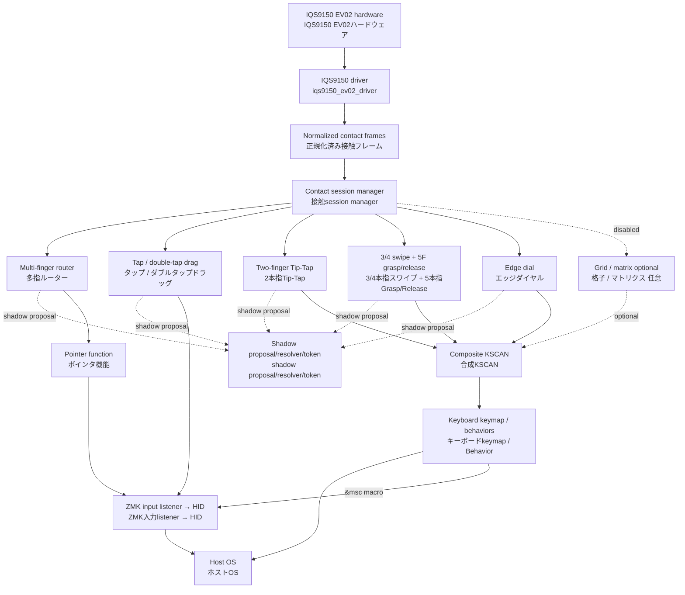

# Travelers Pad architecture and tuning / アーキテクチャと調整

This document describes the current IQS9150 implementation. It separates the
sensor driver, reusable function modules, and keyboard-specific ZMK settings.
It also marks functions that are present but disabled or not assigned.

この文書は現在のIQS9150実装を対象とします。センサードライバ、再利用可能な
機能モジュール、キーボード固有のZMK設定を分離して説明します。実装済みでも無効、
または未割当の機能は明記します。

## Dependency graph / 依存関係



`iqs9150_session` is the sole raw-frame subscriber and republishes normalized
frames to each function. All five primary recognizers—`iqs9150_multifinger_router`,
`iqs9150_tap_drag`, `iqs9150_tip_tap`, `iqs9150_multifinger_gesture_kscan`, and
`iqs9150_edge_dial`—submit proposals to its shadow resolver. Tip-Tap represents
repeated actions under one held anchor as one shadow token; multi-finger gesture
and edge dial submit one claim per contact session. The resolver waits for all
queued-frame acknowledgements rather than relying on callback timing, but the
existing shared-claim and semantic-output paths remain authoritative.

Each exclusive output is recorded against the frame that established its shadow
token. This output-gate preflight reports a token/owner/capability mismatch but
does not yet reject the output. It is the final no-UX-change checkpoint before
all five gates switch together to authoritative mode.

`iqs9150_session` は唯一の生frame購読者であり、正規化frameを各機能へ再配信します。
現在のshadow段階では、5つのprimary recognizerである `iqs9150_multifinger_router`、
`iqs9150_tap_drag`、`iqs9150_tip_tap`、`iqs9150_multifinger_gesture_kscan`、
`iqs9150_edge_dial` がresolverへproposalを送ります。Tip-Tapはanchor維持中の繰返しを一つの
shadow tokenとして扱い、多指gestureとedge dialは接触sessionごとに一つのclaimを提出します。
resolverはcallback時刻に依存せず、queue経由の全者のframe通知を待つが、既存のshared claimと
semantic output経路を引き続き正とします。

各排他的出力はshadow tokenを確立したframeへ記録する。この出力gate事前監査は
token／owner／capability不一致を記録するが、まだ出力を拒否しない。5機能のgateを
authoritative modeへ一括切替する前の、UXを変えない最後の確認段階である。

## Internal layout / 内部配置

The repository is already arranged along the future repository boundary. This
is only an internal move: compatible strings, Kconfig symbols, Devicetree
properties, and keyboard settings are unchanged.

リポジトリは将来のリポジトリ境界に沿って既に配置しています。これは内部移動だけであり、
compatible文字列、Kconfigシンボル、Devicetreeプロパティ、キーボード設定は変わりません。

```text
src/
├── driver/iqs9150/                 # Future zmk-iqs9150-driver
│   ├── iqs9150_ev02_driver.c
│   └── iqs9150_ev02_init.h
├── function/iqs9150/               # Future zmk-iqs9150-functions
│   ├── core/                        # Router + pointer/2F scroll
│   ├── tap_drag/
│   ├── multifinger_gesture/
│   ├── edge_dial/
│   └── grid_adapter/                # Optional; disabled by default
└── platform/xiao/                   # XIAO-specific diagnostics
```

## Layer responsibilities / レイヤーごとの責務

| Layer / 層 | Component / 構成要素 | Responsibility / 責務 | Output / 出力 | Status / 状態 |
|---|---|---|---|---|
| Sensor driver / センサードライバ | `src/driver/iqs9150/iqs9150_ev02_driver.c` | I2C, EV02 initialization, ATI, product/status validation, contact decoding, up to five contact coordinates / I2C、EV02初期化、ATI、製品・状態検証、接触復号、最大5点座標 | Normalized absolute contact frames / 正規化済み絶対座標フレーム | Enabled / 有効 |
| Contact session / 接触session | `iqs9150_session`, `contact_arbiter` | Session ID, normal-end/cancel boundary, shadow proposal collection, deterministic resolver, and output-gate preflight / session ID、通常終了・cancel境界、shadow proposal収集、決定的resolver、出力gate事前監査 | Republished contact frames; shadow owner token / 再配信接触frame、shadow owner token | Shadow migration; output preflight / shadow移行中・出力事前監査 |
| Arbitration / 排他制御 | `iqs9150_multifinger_router` | Selects pointer, 2F scroll, geometry claim, 3–5F gesture, edge, or drag ownership / ポインタ、2本指スクロール、ジオメトリ、3〜5本指、エッジ、ドラッグの経路選択 | Routed contact frames / 振り分け済み接触フレーム | Legacy-authoritative; router proposal enabled / legacyが正、router proposal有効 |
| Pointer / ポインタ | `iqs9150_pointer` | 1F relative pointer; 2F axis lock, discontinuity rejection, and wheel conversion / 1本指相対ポインタ、2本指軸ロック・不連続除外・ホイール変換 | `REL_X/Y`, `REL_WHEEL/HWHEEL` | Enabled / 有効 |
| Tap/drag / タップ・ドラッグ | `iqs9150_tap_drag` | 1/2/3F click; same-count double-tap + hold + move drag / 1/2/3本指クリック、同本数ダブルタップ+ホールド+移動ドラッグ | Mouse buttons and relative movement / マウスボタン・相対移動 | Legacy-authoritative; drag proposal enabled / legacyが正、drag proposal有効 |
| Tip-Tap / Tip-Tap | `iqs9150_tip_tap` | Anchored 2F left/right virtual-key tap; repeats while the anchor stays down / anchorを維持した2本指左右の仮想キーtap、anchor維持中は繰返し可能 | Virtual KSCAN | Legacy-authoritative; one shadow claim per anchored interaction / legacyが正、anchor操作ごとに一つのshadow claim |
| Multi-finger gesture / 多指ジェスチャー | `iqs9150_multifinger_gesture_kscan` | 3/4F directional swipe; 5F independent-coordinate Grasp/Release / 3/4本指方向スワイプ、5本指独立座標Grasp/Release | Virtual KSCAN | Legacy-authoritative; one shadow claim per contact session / legacyが正、接触sessionごとに一つのshadow claim |
| Edge / エッジ | `iqs9150_edge_dial_kscan` | Claims a 1F contact started on an enabled edge; linear trace and local-circle continuation produce repeated virtual KSCAN steps / 有効辺から始まる1本指接触を取得し、直線・局所円継続を仮想KSCANステップ化 | Virtual KSCAN | Legacy-authoritative; one shadow claim per contact session / legacyが正、接触sessionごとに一つのshadow claim |
| Grid / 格子 | `iqs9150_grid_kscan`, `iqs9150_matrix_input`, `zmk-input-matrix` | 3×3 grid tap/flick and optional edge cells / 3×3格子タップ・フリックと任意エッジセル | Virtual KSCAN | Disabled / 無効 |
| ZMK integration / ZMK統合 | Composite KSCAN, keymap, `&kp`, `&mkp`, `&msc` | Maps virtual KSCAN positions to host functions / 仮想KSCAN位置をホスト機能へ割当 | HID reports / HIDレポート | Enabled where mapped / 割当箇所のみ有効 |

## Current keyboard assignment / 現在のキーボード割当

These are keyboard-level bindings in `config/iqs9150_xiao.keymap`; they can be
replaced without changing the sensor driver or function modules.

以下は `config/iqs9150_xiao.keymap` のキーボード側割当です。センサードライバや
機能モジュールを変更せず置換できます。

| Source / 入力 | Direction or action / 方向・操作 | Current binding / 現在の割当 |
|---|---|---|
| 3F swipe / 3本指スワイプ | Left / Right / 左・右 | Mouse Back `MB4` / Mouse Forward `MB5` |
| 3F swipe / 3本指スワイプ | Up / Down / 上・下 | Page Up / Page Down |
| 4F swipe / 4本指スワイプ | Left / Right / Up / Down | Win+Arrow / Win+矢印 |
| 5F geometry / 5本指ジオメトリ | Grasp / Release | Win+M / Win+Shift+M |
| Left edge / 左端 | Down / Up / 下・上 | Brightness down / up / 輝度下げ・上げ |
| Right edge / 右端 | Down / Up / 下・上 | Vertical scroll down / up / 縦スクロール下・上 |
| Top edge / 上端 | Right / Left / 右・左 | Volume up / down / 音量上げ・下げ |
| Bottom edge / 下端 | Right / Left / 右・左 | Horizontal scroll right / left / 横スクロール右・左 |

## Tuning ownership / 調整項目と所有層

Use the keyboard configuration first for user-preference changes. Use function
module properties for recognition thresholds or hardware geometry. Change the
sensor driver only for IQS9150 protocol, initialization, or contact-decoding
issues.

ユーザーの好みはまずキーボード設定で調整します。認識閾値やハードウェア形状は機能
モジュールのプロパティで調整します。IQS9150通信、初期化、接触復号の問題だけを
センサードライバで変更します。

| Function / 機能 | Settings / 設定 | Configure in / 設定場所 | Change scope / 影響範囲 |
|---|---|---|---|
| Host assignment / ホスト割当 | Gesture/edge bindings, `&kp`, `&mkp`, `&msc`, macro speed/hold time / ジェスチャー・エッジ割当、Behavior、マクロ速度・保持時間 | `config/iqs9150_xiao.keymap` | Keyboard only / キーボードのみ |
| 2F scroll direction / 2本指スクロール方向 | `zip_scroll_transform` inversion flags / `zip_scroll_transform` の反転flag | `config/iqs9150_xiao.keymap` override of `&iqs9150_pointer_listener` | Keyboard only / キーボードのみ |
| 2F scroll feel / 2本指スクロール感 | `zip_scroll_scaler` multiplier, axis lock minimum/ratio, maximum per-frame delta / `zip_scroll_scaler` 倍率、軸ロック最小量・比率、最大フレーム差分 | Multiplier: listener in keymap; tracking: `&iqs9150_pointer` / 倍率: keymapのlistener、追跡: `&iqs9150_pointer` | Pointer/2F scroll only / ポインタ・2本指のみ |
| 2F acceleration / 2本指加速 | Not implemented as a setting yet / 現時点では設定未実装 | Future pointer-module setting / 将来のポインタモジュール設定 | 2F scroll only / 2本指のみ |
| 2F inertia / 2本指慣性 | `start-delay-ms`, `repeat-ms`, decay ratio, `stop-delta`, `max-delta` / `start-delay-ms`、`repeat-ms`、減衰比、`stop-delta`、`max-delta` | `&iqs9150_scroll_inertia` in overlay / overlay内の`&iqs9150_scroll_inertia` | Router-committed, axis-locked 2F wheel only / router確定済み・軸ロック済み2本指ホイールのみ |
| Tap and drag / タップ・ドラッグ | `tap-max-ms`, `tap-max-move`, `multifinger-settle-ms`, `double-tap-max-gap-ms`, `double-tap-max-distance`, `drag-start-move` (activation threshold; its accumulated movement is rebased) / 開始閾値（その累積移動は再基準化） | `&iqs9150_tap_drag` in overlay / overlay内の `&iqs9150_tap_drag` | Tap/drag only / タップ・ドラッグのみ |
| 3/4F swipe / 3/4本指スワイプ | `swipe-min-move`, `swipe-max-ms` | `&iqs9150_gesture_kscan` in overlay | 3/4F only / 3/4本指のみ |
| 5F Grasp/Release / 5本指Grasp/Release | `five-finger-radial-move`, `five-finger-stable-frames` | `&iqs9150_gesture_kscan` in overlay | 5F only / 5本指のみ |
| Edge enablement / エッジ有効化 | `edge-left`, `edge-right`, `edge-top`, `edge-bottom` | `&iqs9150_edge_dial` in overlay | Selected edges only / 選択辺のみ |
| Edge recognition / エッジ認識 | Surface size, `edge-size`, linear/circle movement thresholds, local circle entry/corner position / 面サイズ、辺幅、直線・円の移動閾値、局所円の進入・中心位置 | `&iqs9150_edge_dial` in overlay | Edge module only / エッジのみ |
| Edge hold continuation / エッジホールド継続 | Surface size, `edge-size`, drag/scroll start delay, repeat interval and delta / 面サイズ、`edge-size`、ドラッグ／スクロールの開始遅延、繰返し周期・移動量 | `&iqs9150_edge_hold_continue` + listener in overlay | Drag and axis-locked 2F scroll; either finger may reach only the forward, axis-matching edge; wheel output re-enters the normal pointer listener chain / ドラッグと軸ロック済み2本指スクロール。いずれかの指が軸・進行方向に対応する辺へ達すると有効。ホイール出力は通常ポインタのlistener chainへ再入力 |
| Grid / 格子 | Grid settle time, transform, key bindings / 格子安定化時間、transform、キー割当 | Optional module overlay + keymap | Disabled unless explicitly enabled / 明示的に有効化するまで無効 |
| Pinch/rotation / ピンチ・回転 | Router geometry detection thresholds exist; no host action is assigned / ルーターのジオメトリ検出閾値はあるが、ホスト動作未割当 | `&iqs9150_router`; future function module/keymap | Claimed but no visible action / 排他取得のみ、可視動作なし |

## Important boundary rules / 重要な境界ルール

1. The driver must not decide host keycodes, scrolling speed preferences, or
   application actions. / ドライバはホストのキーコード、スクロール速度の好み、
   アプリ操作を決めない。
2. Function modules classify contact data and protect incompatible streams from
   each other. / 機能モジュールは接触データを分類し、競合する入力経路を相互に保護する。
3. KSCAN-producing functions are assigned through the keyboard keymap. /
   KSCAN出力の機能はキーボードkeymapで割り当てる。
4. The 2F scroll path keeps IQS9150-specific contact-transition handling and
   discontinuity rejection in the pointer function, then sends wheel events
   through listener-owned standard transform/scaler processors. /
   2本指スクロールはIQS9150固有の接触遷移処理と不連続除外をポインタ機能に残し、
   その後のホイールイベントをlistener所有の標準transform/scaler processorへ渡す。
5. An enabled edge owns a contact as soon as it starts within that edge. It does
   not emit ordinary pointer movement before its first action. / 有効辺はその辺から始まる
   接触を取得時点で所有し、最初のアクション前でも通常ポインタ移動を出力しない。

## Explicitly not implemented / 現時点で未実装

- User-visible pinch action / ユーザー可視のピンチ操作
- User-visible rotation action / ユーザー可視の回転操作
- Configurable 2F scroll acceleration / 設定可能な2本指スクロール加速
- Enabled and mapped 3×3 grid mode / 有効化・割当済みの3×3格子モード
- Edge-hold continuation HID output / エッジホールド継続のHID出力

The router already claims two-finger geometry so it does not leak into pointer
or scroll output. A future pinch/rotation module should consume that claimed
path and publish its own KSCAN or input events.

ルーターは既に2本指ジオメトリを取得し、ポインタ・スクロールへ漏れないようにして
います。将来のピンチ・回転モジュールはこの取得済み経路を利用し、独自のKSCANまたは
input eventを出力します。
