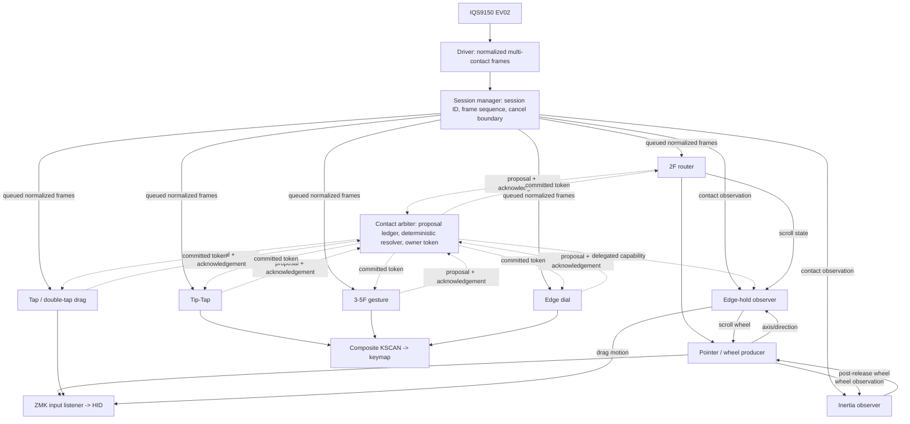

# Travelers Pad contact-arbiter solution review / 接触arbiterソリューション・レビュー依頼

## Review request / 依頼内容

Review and, if justified, redesign the **contact-processing architecture** of
this IQS9150 trackpad. This is an architecture/design review only: do not edit
code, alter configuration, build firmware, or prescribe environment setup.

IQS9150トラックパッドの**接触処理アーキテクチャ**をレビューし、必要なら再設計して
ください。これはアーキテクチャ／設計レビューだけを目的とします。コード、設定、ファームを
変更せず、実装環境のセットアップも扱わないでください。

The current solution is hardware-verified and must be treated as a working
baseline, not as a failure to replace casually. Assess whether it should be
kept, simplified, or evolved, and describe migration steps that preserve its
verified behavior.

現行ソリューションは実機確認済みであり、安易に置換すべき失敗作ではなく、動作する基準実装
として扱ってください。維持・単純化・発展のどれが妥当かを評価し、実証済みの操作感を守る
移行手順を示してください。

## Current verified capabilities / 現在確認済みの機能

- IQS9150 EV02 initialization, ATI, Event Mode, runtime recovery.
- One-finger relative pointer.
- Axis-locked two-finger vertical/horizontal scroll, direction/scale adjustment
  through listener input processors, scroll inertia, and edge continuation.
- One/two/three-finger left/right/middle tap; same-count double-tap + hold +
  move drag. A second stationary tap release is a double click, not a drag.
- Tip-Tap with repeated actions while its anchor remains down.
- Three/four-finger directional swipe and five-finger independent-coordinate
  Grasp/Release, all mapped through virtual KSCAN/keymap.
- Edge dial with selectable sides, linear trace, and corner-local circular
  continuation; edge-hold continuation for drag and committed 2F scroll.
- Pinch/rotation classification suppresses scroll leakage, but has no host
  action assigned. Configurable acceleration is deliberately deferred.

- IQS9150 EV02初期化、ATI、Event Mode、実行中復帰。
- 1本指相対ポインタ。
- 軸ロック済み2本指縦横スクロール、listener input processorによる方向・倍率調整、
  慣性、エッジ継続。
- 1/2/3本指の左／右／中タップ、同本数ダブルタップ＋ホールド＋移動によるドラッグ。
  2回目を静止して離した場合はドラッグではなくダブルクリック。
- anchorを保持する限り繰り返せるTip-Tap。
- 仮想KSCAN／keymap経由の3/4本指方向スワイプ、独立座標を使う5本指
  Grasp/Release。
- 任意辺選択、直線軌跡、角に寄せた局所円継続を持つedge dial、確定dragと確定2本指
  スクロールのedge-hold継続。
- ピンチ／回転はスクロールへの混入を抑止するが、ホスト操作は未割当。設定可能な加速は
  意図的に未実装。

## Current processing and ownership path / 現在の処理・所有権経路

`iqs9150_session` is the only direct subscriber to IQS9150 contact frames. It
creates immutable logical session/frame metadata, calls `arbiter_begin_frame`,
and republishes the frame. Each enabled recognizer receives queued input in
FIFO order, obtains its corresponding frame sequence, processes the frame,
submits a proposal if applicable, and acknowledges observation. The arbiter
resolves only after all registered recognizers have acknowledged the frame;
therefore callback registration order cannot decide the winner.

`iqs9150_session` だけがIQS9150接触frameを直接購読する。不変の論理session／frame
metadataを作り、`arbiter_begin_frame` を呼んでframeを再配信する。各有効recognizerは
queueのFIFO順で入力を受け、対応frame sequenceを取得して処理し、必要ならproposalを提出し、
観測を確認する。arbiterは登録済み全recognizerの確認後にだけ解決するため、callback登録順が
勝者を決めない。

### Owners, capabilities, and precedence / owner・capability・優先順位

The arbiter has one owner per contact session. A primary claim carries a
requested owner and allowed capabilities (`pointer delta`, `scroll delta`,
`button`, `behavior action`). Current policy priority is fixed in code:

| Priority / 優先度 | Owner / owner | Recognizer / 認識器 | Primary output / 主出力 |
| ---: | --- | --- | --- |
| 100 | `edge-dial` | edge dial | Virtual KSCAN / 仮想KSCAN |
| 90 | `drag` | tap/drag | Button + relative drag / ボタン＋相対ドラッグ |
| 80 | `gesture` | 3–5F gesture | Virtual KSCAN / 仮想KSCAN |
| 70 | `scroll` | 2F router | Wheel through pointer/listener / pointer・listener経由ホイール |
| 60 | `tip-tap` | Tip-Tap | Virtual KSCAN / 仮想KSCAN |
| 10 | `pointer provisional` | router | Suppression only; no exclusive semantic output / 抑止だけ。排他的semantic出力なし |

### Token lifetime / tokenの生存期間

1. **Provisional:** a submitted claim is visible before all queued listeners
   acknowledge the frame. It can suppress an incompatible raw path, but never
   authorizes semantic output.
2. **Committed:** the deterministic winner receives a token after all
   acknowledgements. First output is dispatched through a resolver callback;
   continuation output must pass the owner/capability gate.
3. **Terminal:** the owner remains queryable while the terminal frame is
   processed. The live token is then invalidated. Button release is always
   sent as a fail-safe and recorded diagnostically, so a stale token cannot
   leave a host button held.
4. **Observer continuation:** edge hold has no owner and can emit only while a
   live drag or scroll token explicitly grants its capability. Scroll inertia
   observes the terminal frame's scroll owner, then emits post-release decay;
   new physical contact cancels it immediately.

1. **暫定:** 提出済みclaimは、全queued listenerがframeを確認する前から見える。
   非互換な生経路を抑止できるが、semantic出力は許可しない。
2. **確定:** 全確認後に決定的な勝者へtokenを発行する。初回出力はresolver callbackから
   dispatchし、継続出力はowner/capability gateを通す。
3. **終端:** terminal frame処理中はownerを問い合わせられる。その後live tokenを無効化する。
   stale tokenでホストの押下状態が残らないよう、button releaseは常に送信し診断記録する。
4. **observer継続:** edge hold自身はownerを持たず、liveなdragまたはscroll tokenが
   capabilityを明示委譲した間だけ出力できる。scroll inertiaはterminal frameのscroll ownerを
   観測してrelease後の減衰を出し、新規物理接触で直ちに停止する。

## Why this migration happened / この移行に至った経緯

Originally, multiple functions independently subscribed to the driver's contact
stream. Each had local state and partial cross-module queries. This was simple
initially, but equivalent contacts could be classified independently. A notable
failure was a two-finger scroll that later became a tap/drag right click after
release. Drag, edge, and gesture suppression also risked callback-order and
private-state coupling.

当初は複数の機能がdriverの接触ストリームを独立に購読し、局所stateと部分的なモジュール間
問い合わせで制御していた。初期実装は単純だったが、同じ接触が別々に分類され得た。代表的な
不具合は、2本指スクロールが解放後にtap/dragの右クリックへ再解釈されることだった。drag、
edge、gestureの抑止もcallback順やprivate stateへの結合を招いた。

The incremental history from the former `main` baseline to the current `main`
is grouped below. Commit identifiers are supplied so the reviewer can inspect
the exact evolution if desired.

以前の `main` 基準点から現在の `main` までの段階的履歴を以下にまとめる。必要ならreviewerが
正確な進化を確認できるようcommit IDも記載する。

| Stage / 段階 | What changed / 変更内容 | Representative commits / 代表commit |
| --- | --- | --- |
| 1. Session foundation / session基盤 | Added session IDs, frame sequence, cancellation boundary; then routed function consumers through the session manager. / session ID・frame連番・取消し境界を追加し、機能consumerをsession manager経由へ移行。 | `3242399`, `6e8c8ac` |
| 2. Immediate defect containment / 直近不具合の封じ込め | Suppressed tap after a scroll claim, preserved 3F taps, handled terminal owner. / scroll claim後のtap抑止、3本指tap保存、terminal owner処理。 | `cb1423d`, `b00262b`, `6621fb3` |
| 3. Arbiter prototype / arbiter試作 | Added proposal ledger, asynchronous queued-frame resolution, and diagnostic output checks. / proposal ledger、queued frame解決、出力診断を追加。 | `23c3089`, `9c79127`, `3f2e692` |
| 4. Primary-token migration / primary token移行 | Deferred first actions until resolve; token-gated continuation; migrated drag, gesture, edge dial, Tip-Tap. / resolve後の初回出力、継続gate、drag・gesture・edge・Tip-Tap移行。 | `6ba5267`, `14235eb`, `4526346`, `101f38e`, `e29de14`, `440a71c` |
| 5. UX corrections / UX修正 | Rebased drag activation so threshold-crossing movement does not displace the grabbed item; clarified double-tap release vs drag. / 閾値超過移動で対象をずらさないdrag rebase、double-tap解放とdragの分離。 | `21c4e46`, `a613f17` |
| 6. Auxiliary migration / 補助機能移行 | Bound inertia to a committed scroll terminal owner and delegated edge-hold output through live tokens. / inertiaを確定scrollのterminal ownerへ結び、edge hold出力をlive token経由にした。 | `6c2495e`, `bc8ffc0` |
| 7. Single ownership / 単一所有権化 | Removed shared-claim APIs and recognizer-private drag ownership queries; renamed migration-era vocabulary. / shared-claim APIとrecognizer間private drag問い合わせを削除し、移行期語彙を整理。 | `e082ca0` |
| 8. Regression closure / 回帰整備完了 | Added structural invariants script, current full hardware integration procedure, and archived obsolete test stages. / 構造不変条件script、現行全入力実機手順、旧試験段階のarchive表記を追加。 | `73748f5` |

## Evidence already obtained / 既に得た根拠

- Clean firmware builds pass.
- The structural regression script verifies one direct raw subscriber, no
  retired shared-claim/private ownership APIs, token gates for all five primary
  recognizers, edge-hold delegation, and inertia terminal-owner consultation.
- Full hardware integration was passed after the single-owner migration. Logs
  contain committed winners for `drag`, `scroll`, `edge-dial`, `tip-tap`, and
  `gesture`, plus expected edge-hold and inertia start/stop. No arbiter output
  rejection, proposal rejection, queue overflow, cancellation, or contact
  frame failure was observed.

- クリーンなファームビルドは合格済み。
- 構造回帰scriptは、直接の生入力購読者が一つだけであること、廃止済みshared-claim／
  private ownership APIが無いこと、5 primaryすべてのtoken gate、edge-hold委譲、
  inertiaのterminal-owner確認を検査する。
- 単一owner化後の全入力実機試験は合格済み。ログに `drag`、`scroll`、`edge-dial`、
  `tip-tap`、`gesture` の確定winner、期待どおりのedge-holdとinertia開始／停止がある。
  arbiter出力拒否、proposal拒否、queue overflow、取消し、接触frame失敗は観測されていない。

## Important constraints / 重要な制約

1. The driver owns I2C/protocol/EV02 initialization/contact decoding only. It
   must not gain host-action or gesture-policy responsibility.
2. Function modules must remain individually disable-safe: a disabled
   Devicetree node must not register a recognizer or alter the arbitration
   order of enabled modules.
3. Keyboard keymap/behavior owns host assignment. Input processors own user
   preference transforms such as scroll inversion/scaling where possible.
4. No callback-registration order may become a hidden policy input.
5. A primary owner is exclusive per contact session; observers may extend an
   established action but may never establish ownership.
6. Terminal release must remain fail-safe even if architectural cleanup makes
   a token stale.
7. Future modules must not reintroduce a direct subscription to the driver or
   a recognizer-private ownership query.

1. driverの責務はI2C／protocol／EV02初期化／接触復号だけである。ホスト操作やgesture
   policyを戻してはならない。
2. 機能moduleは個別にdisableして安全でなければならない。無効なDevicetree nodeは
   recognizerを登録せず、有効moduleの仲裁順を変えてはならない。
3. キーボードkeymap／behaviorがホスト割当を持つ。可能な限りスクロール反転・倍率などの
   ユーザー設定はinput processorが持つ。
4. callback登録順を隠れたpolicy入力にしてはならない。
5. primary ownerは接触sessionごとに排他的である。observerは確立済み操作を継続できるが、
   所有権を確立してはならない。
6. アーキテクチャ整理でtokenがstaleになってもterminal releaseは安全側でなければならない。
7. 将来moduleはdriver直接購読やrecognizer-private所有権問い合わせを再導入してはならない。

## Specific design questions / 重点レビュー論点

1. Is a single winner per **session** the correct granularity for every current
   and planned operation, or should the model formally distinguish session,
   phase, and post-session continuation ownership?
2. Is the provisional-owner mechanism the narrowest safe way to suppress an
   incompatible stream before queued-frame resolution, or can it create a
   priority inversion, latency, or accidental observation-order dependency?
3. The registered recognizer mask includes primary recognizers and observers.
   Should observer acknowledgement be on the primary resolution critical path,
   or should observers receive an immutable resolved event afterward?
4. Inertia is intentionally post-release: it consults terminal scroll ownership
   before starting, then runs without a live primary token until a new touch
   cancels it. Should this become an explicit time-bounded `POST_SESSION` lease
   token? Compare correctness, API clarity, cancellation safety, and testability.
5. Edge hold observes several streams (contact, router state, pointer motion).
   Is there a cleaner typed derived-event contract that retains its current
   behavior without creating a second de facto routing path?
6. Is the present priority order correct for user intent, especially edge dial
   above drag and gesture, and drag above multi-finger gesture? Identify cases
   where contact start location, finger count, or temporal evidence should
   override a global fixed priority.
7. How should pinch/rotation actions and configurable acceleration be added
   without giving the router excessive policy responsibility or bypassing
   arbiter token ownership?
8. Recommend the long-term repository boundary: IQS9150 driver versus one
   cohesive Travelers Pad functions module versus optional independent input
   processors/behaviors. Avoid excessive package fragmentation.
9. Recommend a test strategy beyond the current build + structural script +
   hardware procedure. In particular, identify deterministic tests for queued
   acknowledgement order, terminal handling, cancellation, module disablement,
   and observer timer races.

1. 現在・将来の全操作に対して、sessionごとに単一winnerという粒度は適切か。それとも
   session、phase、post-session継続の所有権を正式に区別すべきか。
2. queued-frame解決前の非互換stream抑止に、provisional ownerは最小かつ安全な方法か。
   priority inversion、遅延、観測順依存を生まないか。
3. 登録recognizer maskにはprimaryとobserverが入る。observerの確認はprimary解決の
   critical pathに置くべきか、解決済み不変eventを後から渡すべきか。
4. inertiaはrelease後に動くため、terminal scroll ownerを確認して開始後は新規接触まで
   live primary tokenなしで動く。これを期限付き `POST_SESSION` lease tokenにすべきか。
   正確性、APIの明瞭性、cancel安全性、テスト性で比較してください。
5. edge holdはcontact、router state、pointer motionの複数streamを観測する。現在の機能を
   保ちながら、事実上の第2 routing pathを作らない型付きderived-event contractはあるか。
6. edge dial > drag > gesture > scrollという固定優先度はユーザー意図に合うか。接触開始位置、
   指数、時間的evidenceが固定優先度を上書きすべきケースを示してください。
7. ピンチ／回転動作、設定可能な加速を、routerに過剰なpolicy責務を与えずarbiter tokenを
   bypassせずに追加する方法は何か。
8. 長期的なrepository境界を提案してください。IQS9150 driver、凝集したTravelers Pad
   functions module、任意の独立input processor／behaviorをどう分けるべきか。過剰分割は避ける。
9. 現在の build＋構造script＋実機手順を超えるテスト戦略を提案してください。特にqueued
   acknowledgement順、terminal処理、cancel、module disable、observer timer raceを決定的に
   試験する方法を示してください。

## Required review output / 求めるレビュー成果物

1. **Verdict:** retain, refine, or replace the current architecture, with an
   evidence-based reason.
2. **At least two alternatives:** compare the current design with at least one
   materially different design. Include coupling, disable safety, latency,
   future extensibility, migration risk, and testability.
3. **Recommended target:** Mermaid diagrams for data flow, control/ownership
   flow, token/lease lifetime, and cancellation/release paths.
4. **Responsibility table:** driver, session boundary, arbiter, each primary,
   each observer, input processors, behaviors, and keymap.
5. **Priority and state rules:** state exact conflict and tie-breaking rules;
   explicitly handle drag, scroll, edge dial, Tip-Tap, 3–5F gestures,
   pinch/rotation, inertia, edge hold, and cancellation.
6. **Migration plan:** small reversible stages that preserve all verified
   behavior. State the minimal regression test for every stage.
7. **Test plan:** distinguish deterministic automated tests, structural checks,
   and hardware integration tests. Do not call a hardware-only check a unit
   test.
8. **Open decisions:** identify choices that require product/UX input rather
   than an engineering assumption.

1. **結論:** 現行を維持・改善・置換のどれにするか、根拠とともに示す。
2. **少なくとも2案:** 現行設計と、実質的に異なる少なくとも1案を比較する。結合度、disable
   安全性、遅延、将来拡張性、移行リスク、テスト性を含める。
3. **推奨到達点:** data flow、制御／所有権flow、token／lease生存期間、取消し／解放経路を
   Mermaidで示す。
4. **責務表:** driver、session境界、arbiter、各primary、各observer、input processor、
   behavior、keymapを明確にする。
5. **優先順位・状態規則:** 競合・tie-break規則を厳密に示す。drag、scroll、edge dial、Tip-Tap、
   3〜5本指gesture、pinch／rotation、inertia、edge hold、cancelを明示的に扱う。
6. **移行計画:** 実機確認済み操作を守る小さく可逆な段階に分け、各段階の最小回帰試験を示す。
7. **試験計画:** 決定的自動試験、構造検査、実機結合試験を分ける。実機だけの確認をunit testと
   呼ばない。
8. **未決定事項:** 工学的仮定でなく、製品／UX判断が必要な選択を特定する。

## Relevant current files / 参照すべき現行ファイル

- `docs/architecture-and-tuning.md` — current responsibility and dependency
  reference / 現行の責務・依存関係。
- `src/function/iqs9150/session/contact_session_manager.c` — canonical session
  boundary / 正規session境界。
- `src/function/iqs9150/session/contact_arbiter.c` and
  `include/travelers_pad/contact_arbiter.h` — proposal, priority, token API /
  proposal、優先順位、token API。
- `src/function/iqs9150/core/iqs9150_multifinger_router.c` — pointer/scroll
  classification / ポインタ・スクロール分類。
- `src/function/iqs9150/tap_drag/iqs9150_tap_drag.c`, `tip_tap/`,
  `multifinger_gesture/`, `edge_dial/` — primary recognizers / primary認識器。
- `src/function/iqs9150/edge_hold_continue/` and `scroll_inertia/` — observer
  continuations / observer継続。
- `boards/shields/iqs9150_xiao/iqs9150_xiao.overlay` — active wiring of the
  modules / 現行moduleの接続。
- `docs/all-input-integration-test.md` and
  `scripts/verify-contact-arbiter-architecture.sh` — present regression gate /
  現在の回帰ゲート。
