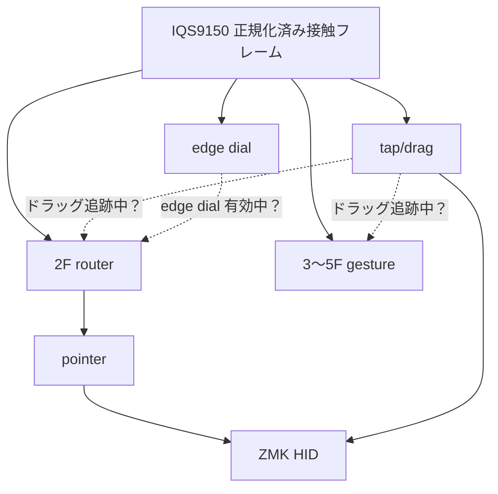

# トラックパッド処理経路・アーキテクチャ設計レビュー依頼

以下のZMK + IQS9150EV02トラックパッドについて、**接触フレームの処理経路、所有権、およびモジュール責務**を再設計してください。

この依頼では実装を行わず、既存アーキテクチャの分析、設計案の比較、および段階的な移行・検証計画だけを提示してください。文書は日本語を主とし、必要に応じて英語用語を併記してください。

## 目的

現在、IQS9150ドライバが発行する接触フレームを複数の機能モジュールが並列に購読し、同じ指の接触を独立に解釈しています。

その結果、2本指スクロールとして確定した接触を tap/drag モジュールが短い2本指タップとして再解釈し、右クリックを遅れて誤発火する問題を確認しました。

場当たり的な抑止ではなく、以下を満たす保守しやすい処理経路・所有権モデルを提案してください。

- ポインタ、2本指スクロール、タップ、ドラッグ、3〜5本指ジェスチャー、エッジ操作、慣性を矛盾なく共存させる。
- 接触セッションごとに、どの機能が所有権を得るかを明確にする。
- 各機能モジュールを有効・無効にしても、他の機能が不正な状態や不自然な動作にならない。
- 将来の pinch / rotate、加速、反転、input processor による調整を追加しやすい。
- 現在確認済みのユーザー体験を不必要に壊さない。
- 循環依存、暗黙の優先順位、複数箇所の重複判定を減らす。
- デバッグログ、単体テスト、統合テストを設計しやすくする。

## 現在の構成

IQS9150ドライバは、正規化済みの接触フレームを input event として発行します。現状、主に次の機能が同じ生フレームを独立に購読しています。

- **2F router**
  - 1本指ポインタと2本指スクロールを分類し、pointer モジュールへ渡す。
- **tap/drag**
  - 1/2/3本指タップ。
  - ダブルタップ＋ホールドによる左/右/中クリックのドラッグ。
- **3〜5F gesture**
  - 3/4本指スワイプ。
  - 5本指 Grasp / Release。
- **edge dial**
  - 有効辺をなぞる連続操作。
- **edge hold**
  - パッド端でのドラッグ継続、2本指スクロール継続。
- **scroll inertia**
  - 2本指スクロールのリリース後に、減衰するホイールイベントを再投入する機能。

## 現行の概略経路

### 現在の優先制御

- `tap/drag → 2F router` の「ドラッグ追跡中」問い合わせがある。
  - ダブルタップ＋ホールド中の接触を、router が2本指スクロールとして奪わないため。
- `edge dial → 2F router` の「edge dial 有効中」問い合わせがある。
- 一方で、`2F router → tap/drag` の「この接触はスクロールとして確定した」という通知はない。
  - これが、スクロール終了後の右クリック誤発火につながる。

## 検討してほしい論点

### 1. 実際のデータ経路と制御経路の分離

以下を明確に区別してください。

- 生の接触フレーム（raw contact frame）の配信。
- 派生イベント（pointer / scroll / gesture / key / HID）の配信。
- 所有権の問い合わせ・取得・解除・キャンセル。
- セッション状態の保持場所。

処理が単なる直列パイプラインではなく、複数購読者による fan-out である点を踏まえてください。

### 2. 少なくとも2案の比較

少なくとも以下を比較してください。

1. **最小変更案**
   - 2F router がスクロール確定時に tap/drag へ `scroll claimed` を一方向に通知し、同一接触セッションのタップ判定を抑止する方式。
2. **集中仲裁案**
   - 接触セッションを管理する arbiter / session manager を設け、各機能へイベントを振り分ける方式。

必要であれば第三案も示してください。各案について、次を比較してください。

- モジュール間依存と循環依存のリスク。
- 有効・無効の組み合わせに対する安全性。
- 新機能の追加容易性。
- デバッグ容易性。
- 既存動作への影響。
- 移行コスト。
- 必要な実機テスト量。

### 3. 接触セッションと優先順位

以下を含む状態遷移・優先順位を提案してください。

- 接触開始、指本数増減、移動、静止、リリース。
- タップ候補、ダブルタップ候補、ホールド、ドラッグ。
- 2本指スクロール候補とスクロール確定。
- 3〜5本指ジェスチャー候補と確定。
- edge dial / edge hold の取得。
- 慣性スクロール開始と停止。
- 所有権の競合時、確定済み経路への遷移後、キャンセル時の扱い。

特に「スクロールに確定した接触は、リリースまで tap/drag のクリックにならない」ことを保証してください。

## 既知の機能・仕様

- 1本指ポインタ、2本指スクロール、1/2/3本指タップ・ドラッグ、3/4本指スワイプ、5本指 Grasp/Release、edge dial、edge hold は概ね実機確認済み。
- drag 中は router がスクロールに奪われてはいけない。
- スクロールに確定した接触は tap/drag がクリックとして扱ってはいけない。
- 1本指タップ直後に2本指タップを行う場合、左クリック後に右クリックが送られる仕様は許容済み。
- pinch / rotate は未実装。
- スクロール方向反転、速度、加速などは、将来的に input processor で調整可能にしたい。
- edge dial はキー割当可能な設計を維持したい。

## 求める成果物

実装に進む前に、以下を提出してください。

1. 現行アーキテクチャの整理
   - データ経路、制御経路、未表現の依存関係。
2. 設計案の比較表
   - 最小変更案と集中仲裁案を含む。
3. 推奨アーキテクチャ
   - Mermaid による改修後の処理経路図。
   - モジュール責務、接触セッション、所有権、優先順位、解除条件を明文化。
4. 段階的な移行計画
   - 既存機能を壊さない実装順序。
   - 各段階の単体テストおよび最小限の実機統合テスト。
   - モジュールの有効・無効組み合わせに対する確認方針。

この段階では、コード変更、コミット、ファーム生成は行わないでください。
