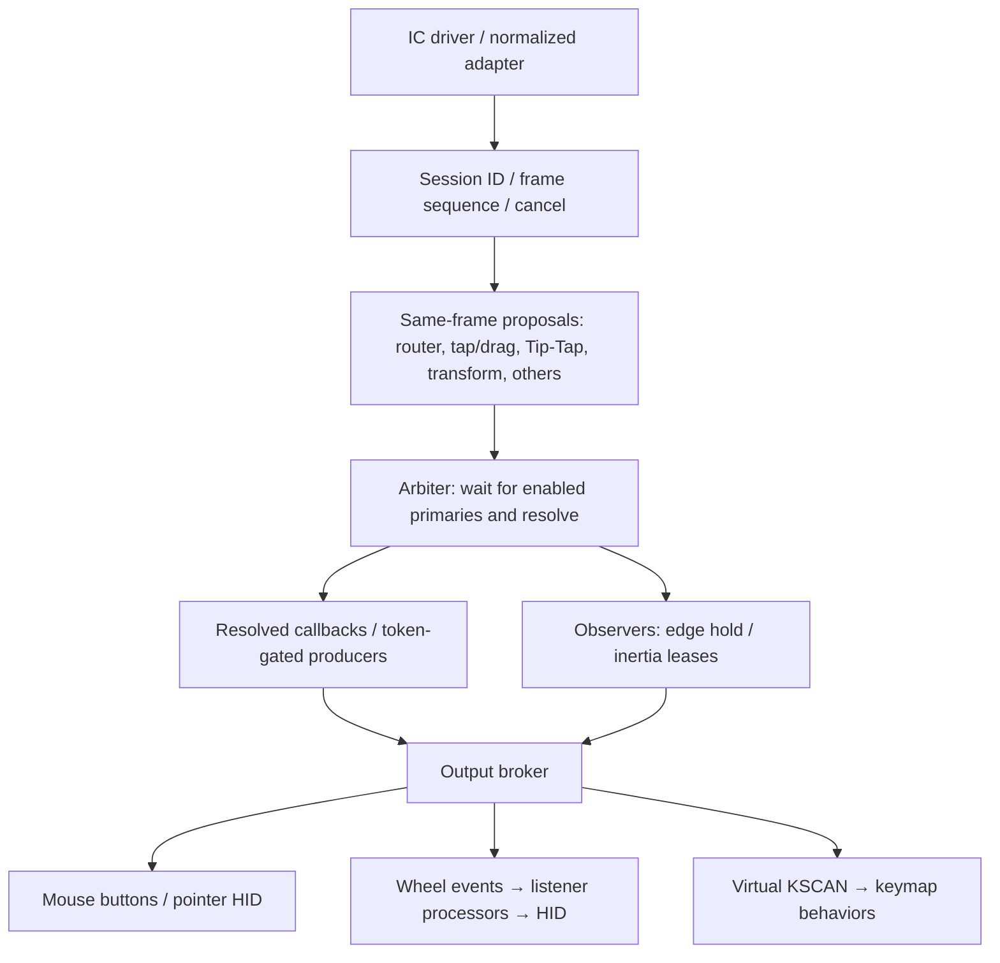
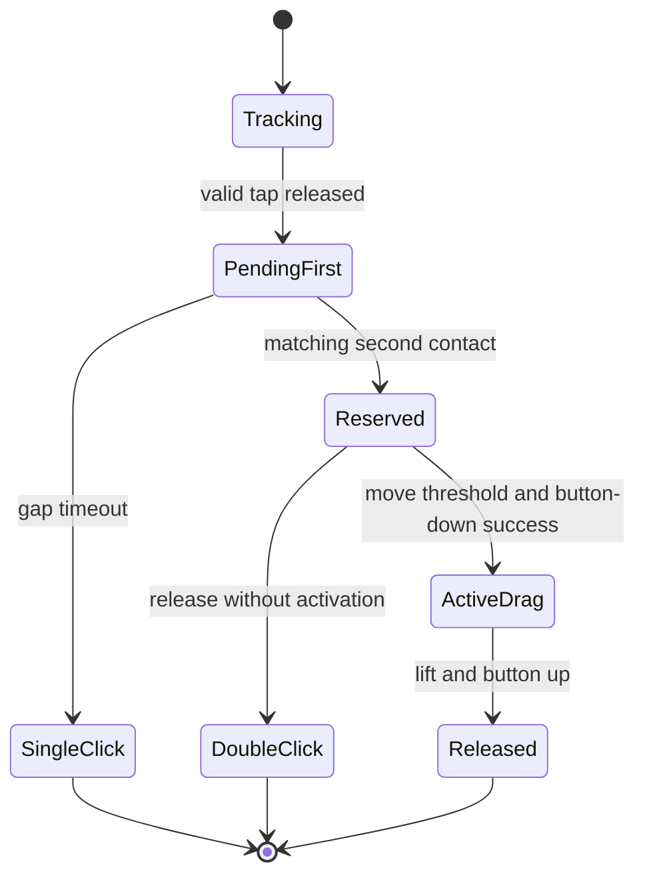

# One/two-finger interaction flow / 1・2本指操作と処理フロー

Reference: main c76e3e0 (2026-09-28). Read this document first when adapting the policy to another IC.
参照: main c76e3e0（2026-09-28）。別ICへの操作policy移植では本書から読み始める。
This is an implementation reference, with outstanding safety limitations below.
本書は現行実装の参照仕様であり、末尾に残る安全性課題を記載する。

## Contact contract / 接触入力契約

The adapter supplies coherent frames: contact count, valid contacts, independent X/Y, tracking IDs,
end-of-frame sync, and reset/cancel. A normal zero-contact release differs from sensor reset.
Reset cancels delayed work even outside a live session. Slot number and tracking ID are distinct;
contacts should not change identity merely because the IC changes their ordering.
adapterは本数、有効contact、独立X/Y、tracking ID、frame末尾sync、reset/cancelを揃えて供給する。
通常の全指離しとsensor resetは別であり、session外resetも遅延操作をcancelする。
slot番号とtracking IDは別概念であり、ICによる報告順変更だけでcontactを新規判定しない。

Driver owns initialization, calibration, communication and decoding. Function modules own gesture
policy; keyboard configuration owns bindings and scroll processors. The existing router/transform
use legacy first/second coordinates; tap/drag and Tip-Tap also consume MT slots. Supply consistent
representations or adapt all consumers together. Tip-Tap, pinch/rotation and the current scroll
direction-coherence test require independent two-point coordinates, not merely count plus centroid.
driverは初期化・校正・通信・復号、function moduleはgesture policy、keyboard設定は割当と
scroll processorを担う。現行router/transformはlegacy第1・第2座標、tap/dragとTip-TapはMT slotも
使う。両表現を整合して供給するかconsumerを一括適応する。Tip-Tap、pinch/rotation、
現行scroll方向整合判定には独立2点が必要であり、本数と重心だけでは不足する。

Current recognizers reconstruct contacts from individual republished input events. The immutable
session snapshot contains lifecycle metadata, not a complete contact array. An immutable complete
ContactFrame remains a future design target; do not assume that API already exists.
現行recognizerは再配信された個別input eventからcontactを復元する。immutable session snapshotは
lifecycle情報のみで、immutable完全ContactFrame APIはまだ実装されていない。

## Processing flow / 処理フロー

No decision is published until all enabled primaries observe that frame. Router forwards from
the resolved callback only. Ordinary pointer uses a frame-bound routed permit without a gesture
owner; POINTER is not an extra enum owner. Terminal tap/double-click uses a one-shot action grant;
observer output requires a revocable lease. The broker checks authority immediately before output.
同一frameを有効primary全員が観測してから裁定を公開する。routerのforwardは裁定後callbackだけ。
通常pointerはgesture ownerが無くてもframe付きrouted permitを使い、POINTER専用enum ownerは無い。
終了tap/double-clickは一回限りgrant、observer出力は失効可能leaseを使う。brokerが出力直前に認可する。

## Operations / 操作仕様

| Operation / 操作 | Recognition / 判定 | Default output / 既定出力 |
|---|---|---|
| 1F single-tap | Short stationary touch, release, then gap timeout / 静止接触・離指・gap満了 | Left click / 左click |
| 1F double-tap | Nearby same-count second touch in gap, release without drag activation / 同本数・近接・gap内、2回目は動かさず離す | Left double-click |
| 1F tap-hold-drag | First tap and lift, second touch held and moved / tap・離指・2回目保持して移動 | Left-button drag |
| 2F single-tap | Stationary two-contact touch with staggered arrival/lift handling / 時差を含む静止2本指 | Right click / 右click |
| 2F double-tap | Same-count matching second touch, release without drag activation / 2本指で2回、動かさず離す | Right double-click |
| 2F tap-drag | First 2F tap and lift, second 2F touch held and moved / 2F tap・離指・2回目保持して移動 | Right-button drag |
| 2F scroll | Both contacts translate coherently beyond thresholds / 両contactが同方向へ十分移動 | Vertical/horizontal wheel |
| Tip-Tap | Hold anchor, briefly touch/lift second finger to its left/right / anchor保持、左右に2本目を短く接触・解放 | F13/F14 |
| Pinch/rotation | Distance/vector change crosses recognition and incremental thresholds / 距離・vector変化が閾値超過 | Ctrl-minus/equals, F15/F16 |

The term tap-hold-drag requires a preceding tap and lift. A single long press alone does not
start drag. Assignments are configurable policy, not properties of the touch IC.
tap-hold-dragには前のtapと離指が必要であり、1回のlong pressだけではdragを開始しない。
出力割当は設定可能なpolicyでありIC仕様ではない。transformの実機受入は現時点で未完了。

## Tap/drag state transitions / 状態遷移

First click is deferred. A matching second contact requests DRAG RESERVED immediately, suppressing
ordinary pointer/scroll but sending no button-down. Movement beyond drag-start-move sends
button-down; only successful enqueue changes the owner to ACTIVE. The activation frame consumes
the threshold movement and rebases coordinates: the grabbed item stays at the tap position.
Subsequent movement is sent with the button held. Release without activation emits two click
pulses via a terminal grant; tiny motion still falls in this branch.
初回clickを保留する。一致する2回目接触は即DRAG RESERVEDを要求し、通常pointer/scrollを抑止するが、
button-downは送らない。drag-start-move超過でbutton-downを送り、enqueue成功後のみACTIVEになる。
開始frameで認識に使った移動を消費し基準を置き直すため、掴む対象はtap位置に留まる。
以後の移動をbutton保持中に送る。開始前に離す場合は微小移動があっても2click pulseになる。

Count mismatch never means cross-count drag: 1F tap followed by 2F tap should send left then
right click. Multitouch tap/drag uses centroid and contact references to avoid slot-order or
partial-lift jumps. The receiving IC must validate staggered arrival, soft touches and partial lift.
本数違いはcross-count dragではない。1F tap→2F tapは左click→右clickとする。
複数指tap/dragは重心・contact参照を用いてslot順や部分離指の跳びを抑える。
移植先で時差接触・軽い接触・部分離指を検証する。

## Scroll and Tip-Tap arbitration / ScrollとTip-Tapの裁定

Current scroll evidence requires both contact displacements to reach scroll-classify-move and
their dot product to be positive. Distance-squared or vector-cross change competes for
TRANSFORM_GESTURE. A committed SCROLL remains until session end/cancel; priority is not a
per-frame permission to replace an existing owner.
scrollは両contact移動量がscroll-classify-move以上かつ内積が正でproposalする。
距離二乗・外積変化はTRANSFORM_GESTURE候補になる。確定SCROLLは終了/cancelまで維持し、
priorityは確定ownerを毎frame自由に置換する許可ではない。

Tip-Tap requires a valid stationary anchor with the same tracking ID and second-contact motion
within slop. The second finger must lift within timeout and be separated horizontally. The first
completed action claims TIP_TAP; repeated second-finger taps remain valid while anchor stays down.
Final anchor release must not emit an extra right click.
Tip-Tapはanchor ID維持・静止、2本目slop内、timeout内離指、左右separationを要求する。
初回完成actionでTIP_TAPを取得し、anchor保持中は2本目の反復tapが可能。
最後のanchor解放で右clickを追加してはならない。

Same-frame priorities: edge dial 100, drag 90, transform 85, multifinger gesture 80, scroll 70,
Tip-Tap 60; equal priorities use recognizer ID. These apply to eligible proposals only.
同一frameの有効proposal priority: edge dial 100、drag 90、transform 85、多指gesture 80、
scroll 70、Tip-Tap 60。同値はrecognizer IDで決定する。

Edge hold follows ACTIVE drag/scroll with session/generation/epoch-bound auxiliary leases.
Either finger reaching the forward scroll edge can continue scrolling. Inertia starts only after
normal scroll release and obtains a post-session lease; new contact/reset invalidates it.
edge holdはACTIVE drag/scrollへsession・generation・epoch付きleaseで追従する。
scroll前方の辺へいずれかの指が達すれば継続可能。inertiaは通常scroll終了後だけleaseを取得し、
新規contact/resetで失効する。session外resetも全leaseとgrantを失効する。

## Porting and configuration / 移植・設定

Normalize range, sampling rate, axis orientation and units. Squared-distance and cross-product
thresholds have squared coordinate units: do not copy numeric thresholds blindly to another IC.
位置範囲・sample周期・軸方向・単位を正規化する。距離二乗・外積の閾値は座標単位の二乗であり、
別ICへそのまま数値転記しない。可能なら物理距離と時間で調整する。

Tap settings: tap-max-ms, tap-max-move, multifinger-settle-ms, double-tap-max-gap-ms,
double-tap-max-distance, drag-start-move. Scroll uses classification/axis-lock thresholds, then
keyboard-side wheel transform/scaler. Tip-Tap uses timeout/slop/separation. Transform uses separate
recognition and incremental-step thresholds.
tap時間・移動許容量・settle・double gap/距離・drag開始量、scroll分類/軸ロック、
Tip-Tap timeout/slop/separation、transform分類/stepを個別調整する。
wheel反転・倍率はkeyboardのinput processorへ置く。

## Source map / コード対応表

Paths relative to repository root / repository root相対path:

| Responsibility / 責務 | Source |
|---|---|
| Session | src/function/iqs9150/session/contact_session_manager.c; include/travelers_pad/contact_session.h |
| Arbiter | src/function/iqs9150/session/contact_arbiter.c; include/travelers_pad/contact_arbiter.h |
| Broker and button retry | src/function/iqs9150/session/contact_output_broker.c |
| Tap/double-tap/drag | src/function/iqs9150/tap_drag/iqs9150_tap_drag.c |
| Scroll classification/forwarding | src/function/iqs9150/core/iqs9150_multifinger_router.c |
| Pointer/wheel conversion | src/function/iqs9150/core/iqs9150_pointer.c |
| Tip-Tap | src/function/iqs9150/tip_tap/iqs9150_tip_tap_kscan.c |
| Transform | src/function/iqs9150/transform_gesture/iqs9150_transform_gesture.c |
| Observer continuation | src/function/iqs9150/edge_hold_continue/; src/function/iqs9150/scroll_inertia/ |

## Acceptance and limitations / 受入確認・未完了事項

Test 1F/2F single and double taps, second-touch motion versus release, immediate slow drag without
grab-position drift, 1F tap followed by 2F tap, scroll stop/restart, repeated left/right Tip-Tap
with anchor held, transform without wheel/right-click leakage, and normal recovery after each.
Also test reset during timers/inertia and inject release enqueue failures.
1/2F single/double tap、2回目移動と離指、直後のゆっくりdragで掴む位置がずれないこと、
1F tap→2F tap、停止再開scroll、anchor保持中左右Tip-Tap反復、transformのwheel/右click抑止、
通常操作復帰、timer/inertia中reset、release enqueue失敗注入を確認する。

Remaining safety issues include virtual-KSCAN authorization-to-callback concurrency, button-up
fault-injection validation, immutable complete ContactFrame, and optional grid broker migration.
Builds and structural string checks do not prove these conditions safe.
残る課題はvirtual-KSCAN認可〜callbackの並行性、button-up失敗注入試験、immutable完全ContactFrame、
任意gridのbroker移行。build・文字列構造検査だけで安全性を証明したと扱わない。

Read [architecture-and-tuning.md](architecture-and-tuning.md),
[all-input-integration-test.md](all-input-integration-test.md),
[transform-gesture-arbitration-test.md](transform-gesture-arbitration-test.md), and
[arbiter-safety-hardening-test.md](arbiter-safety-hardening-test.md).

Receiving Codex: first map the new IC contact contract, documenting missing coordinates/IDs,
contact ordering and conversion. Preserve observation/proposal/resolution/output separation,
and prepare acceptance checks before tuning thresholds.
受領Codexは新ICのcontact契約、不足する座標/ID、contact順、変換を記録する。
観測・proposal・裁定・出力の分離を維持し、閾値調整前に受入手順を用意する。
